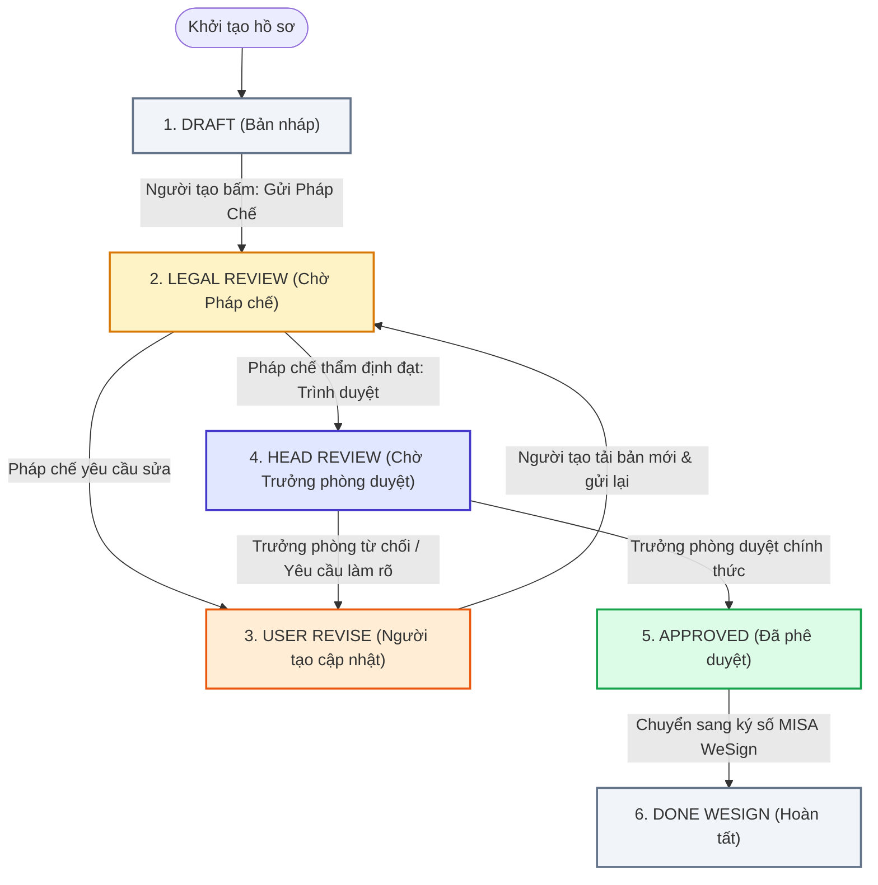

# SỔ TAY HƯỚNG DẪN SỬ DỤNG HỆ THỐNG RÀ SOÁT HỢP ĐỒNG (CONTRACT REVIEW SYSTEM v2.0)

> **Dành cho:** Người phụ trách hợp đồng (User/Sales/PM), Chuyên viên Pháp chế, và Head of Legal.  
> **Phiên bản hệ thống:** v2.0 (Clean Modular Architecture & Firestore Cloud Engine)  
> **Cập nhật lần cuối:** 2026-10-15

---

## MỤC LỤC
1. [GIỚI THIỆU TỔNG QUAN HỆ THỐNG](#1-giới-thiệu-tổng-quan-hệ-thống)
2. [SƠ ĐỒ QUY TRÌNH RÀ SOÁT HỢP ĐỒNG (END-TO-END WORKFLOW)](#2-sơ-đồ-quy-trình-rà-soát-hợp-đồng-end-to-end-workflow)
3. [ĐĂNG NHẬP & BẢNG ĐIỀU KHIỂN (DASHBOARD)](#3-đăng-nhập--bảng-điều-khiển-dashboard)
4. [HƯỚNG DẪN CHO NGƯỜI TẠO YÊU CẦU (USER / SALES / PM)](#4-hướng-dẫn-cho-người-tạo-yêu-cầu-user--sales--pm)
5. [HƯỚNG DẪN CHO CHUYÊN VIÊN PHÁP CHẾ (LEGAL)](#5-hướng-dẫn-cho-chuyên-viên-pháp-chế-legal)
6. [HƯỚNG DẪN CHO HEAD OF LEGAL](#6-hướng-dẫn-cho-trưởng-phòng-pháp-chế-head-of-legal)
7. [HƯỚNG DẪN SỬ DỤNG CÁC TÍNH NĂNG NÂNG CAO](#7-hướng-dẫn-sử-dụng-các-tính-năng-nâng-cao)
8. [QUY TẮC TẬP TIN & LƯU Ý BẢO MẬT QUAN TRỌNG](#8-quy-tắc-tập-tin--lưu-ý-bảo-mật-quan-trọng)
9. [CÂU HỎI THƯỜNG GẶP & XỬ LÝ LỖI (FAQ)](#9-câu-hỏi-thường-gặp--xử-lý-lỗi-faq)

---

## 1. GIỚI THIỆU TỔNG QUAN HỆ THỐNG

**Hệ thống Rà soát Hợp đồng v2.0 (Contract Review System)** là nền tảng trực tuyến giúp số hóa và chuẩn hóa toàn bộ quy trình gửi, rà soát, phản hồi, thẩm định và phê duyệt các văn bản hợp đồng trước khi ký số chính thức.

### 🌟 Lợi ích cốt lõi:
* **Không cần gửi email đính kèm file Word qua lại:** Mọi thao tác trao đổi, đóng góp ý kiến, sửa đổi diễn ra tập trung tại một nơi.
* **Đọc văn bản Word (.docx) trực tiếp trên trình duyệt:** Không cần tải phần mềm Office, xem nhanh Hợp đồng chính và các Phụ lục đính kèm.
* **Trợ lý AI:** Tự động phân tích rủi ro pháp lý, tóm tắt điều khoản thương mại quan trọng và gợi ý quyết định duyệt/không duyệt.
* **Theo dõi lịch sử phiên bản minh bạch:** Mọi thay đổi nội dung, lịch sử trao đổi, ý kiến chỉ đạo đều được ghi nhận (Audit Trail) rõ ràng.
* **Tự động nhắc việc qua Email:** Tự động gửi thông báo khi có hồ sơ mới và tự động nhắc nhở phê duyệt định kỳ nếu hồ sơ bị tồn đọng.

---

## 2. SƠ ĐỒ QUY TRÌNH RÀ SOÁT HỢP ĐỒNG (END-TO-END WORKFLOW)

Quy trình thẩm định hợp đồng trải qua 5 chặng với các trạng thái rõ ràng:



### Bảng giải thích trạng thái hồ sơ:
| Trạng thái hiển thị (Badge) | Màu sắc | Ý nghĩa | Ai là người cần hành động? |
| :--- | :--- | :--- | :--- |
| **Draft** | Xám | Bản thảo mới tạo, chưa nộp | Người tạo (User) |
| **Legal Review** | Vàng cam | Đang chờ Chuyên viên Pháp chế rà soát | Chuyên viên Pháp chế (Legal) |
| **User Revise** | Cam đậm / Đỏ | Có ý kiến góp ý, yêu cầu sửa đổi nội dung | Người tạo (User) |
| **Head Review** | Tím xanh | Pháp chế đã thẩm định, chờ Trưởng phòng duyệt | Trưởng phòng Pháp chế (HOL) |
| **Approved** | Xanh lá | Hồ sơ đã được Trưởng phòng phê duyệt chính thức | Người tạo (Tải về ký số) |
| **Done WeSign** | Xám xanh | Đã hoàn tất ký số điện tử và lưu trữ | Đã hoàn thành |

---

## 3. ĐĂNG NHẬP & BẢNG ĐIỀU KHIỂN (DASHBOARD)

### 3.1. Đăng nhập hệ thống
1. Truy cập vào đường dẫn website của hệ thống: `https://[ten-mien-noi-bo]`
2. Nhấn nút **Đăng nhập bằng Google** (Sử dụng email doanh nghiệp đã được phân quyền).
3. Nếu email của bạn chưa nằm trong danh sách được cấp phép, màn hình sẽ thông báo: *"403 - Chưa được cấp quyền"*. Vui lòng liên hệ Quản trị viên/IT để được thêm vào danh sách Whitelist.

> [!NOTE]
> Hệ thống áp dụng cơ chế xác thực phân quyền nghiêm ngặt: Mỗi người dùng sẽ chỉ thấy những hồ sơ do mình tạo ra (đối với vai trò User) hoặc toàn bộ hồ sơ nghiệp vụ (đối với vai trò Pháp chế & Trưởng phòng).

### 3.2. Làm quen với Giao diện Bảng điều khiển (Dashboard)
Sau khi đăng nhập thành công, bạn sẽ thấy giao diện Dashboard gồm 3 khu vực chính:

```
┌────────────────────────────────────────────────────────────────────────┐
│ [Logo] Contract Review System            🔔 Thông báo   👤 [Tên & Role]│
├────────────────────────────────────────────────────────────────────────┤
│ [📊 THẺ THỐNG KÊ (Metric Cards)]                                      │
│  ┌──────────────┐ ┌──────────────┐ ┌──────────────┐ ┌──────────────┐   │
│  │ 📝 Bản nháp  │ │ ⏳ Chờ Legal │ │ 👑 Chờ Head  │ │ ✅ Đã Duyệt  │   │
│  │ & Cần sửa: 3 │ │ duyệt: 5     │ │ duyệt: 2     │ │: 18          │   │
│  └──────────────┘ └──────────────┘ └──────────────┘ └──────────────┘   │
├────────────────────────────────────────────────────────────────────────┤
│ [🔍 THANH TÌM KIẾM & BỘ LỌC]                 [➕ Tạo Yêu Cầu Mới]      │
├────────────────────────────────────────────────────────────────────────┤
│ [📋 DANH SÁCH HỢP ĐỒNG]                                                │
│ Mã HĐ      │ Tên hợp đồng         │ Đối tác     │ Trạng thái │ Ngày tạo│
│ CR-2026-001│ Mua sắm máy chủ 2026 │ FPT IS      │ Legal Rev. │ 14/10   │
└────────────────────────────────────────────────────────────────────────┘
```

1. **Thẻ thống kê nhanh (Metric Cards):** Nhấn trực tiếp vào từng thẻ (Bản nháp, Chờ Legal, Chờ Head, Đã duyệt) để lọc nhanh danh sách hợp đồng theo nhóm trạng thái.
2. **Thanh tìm kiếm:** Nhập tên hợp đồng, mã số, hoặc tên đối tác/nhà cung cấp để lọc tức thì.
3. **Nút "Tạo Yêu Cầu Mới":** (Chỉ hiển thị cho người dùng có vai trò Người tạo).

---

## 4. HƯỚNG DẪN CHO NGƯỜI TẠO YÊU CẦU (USER / SALES / PM)

### 4.1. Tạo mới một bộ hồ sơ hợp đồng
1. Tại màn hình Dashboard, nhấn nút **+ Tạo Yêu Cầu Mới**.
2. Điền các thông tin trong cửa sổ hiện lên:
   * **Tên hợp đồng (`*`):** Tên ngắn gọn, rõ nghĩa (Ví dụ: *Hợp đồng Mua sắm Bản quyền Phần mềm 2026*).
   * **Đối tác / Nhà cung cấp (`*`):** Tên công ty đối tác ký kết.
   * **Phòng ban:** Mặc định lấy theo phòng ban của bạn.
   * **Mô tả / Ghi chú tóm tắt:** Nêu vắn tắt bối cảnh, giá trị hợp đồng, các điểm lưu ý đặc biệt.
3. **Đính kèm tài liệu:**
   * **Hợp đồng chính (`*`):** Kéo thả hoặc bấm chọn **1 tệp duy nhất định dạng `.docx`** (Dung lượng tối đa 50MB).
   * **Phụ lục đính kèm (Tùy chọn):** Kéo thả hoặc chọn tối đa **5 tệp phụ lục định dạng `.docx`** (Ví dụ: Bảng giá, SLA, Phụ lục bảo mật...).
   > [!IMPORTANT]
   > Tên các tệp phụ lục **không được trùng nhau** và **không được trùng với tên Hợp đồng chính**.
4. Nhấn **Khởi Tạo Hồ Sơ**. Hệ thống sẽ tạo hồ sơ ở trạng thái **Draft**.

---

### 4.2. Kiểm tra và Gửi hồ sơ cho Pháp chế
1. Sau khi tạo, hệ thống tự động đưa bạn vào trang Chi tiết Hợp đồng.
2. Kiểm tra lại văn bản trên Trình đọc văn bản ở nửa trái màn hình.
3. Nếu cần đính kèm các tài liệu bổ trợ không phải file Word (như Báo giá scan `.pdf`, Giấy phép kinh doanh `.png`, Đề xuất mua sắm...):
   * Nhấp sang tab **Đính kèm** (Reference Files) ở cột bên phải.
   * Tải các tệp tham chiếu lên (dung lượng tối đa 20MB/file).
4. Nhấn nút **Gửi Pháp Chế** ở góc trên cùng bên phải màn hình.
5. Nhập ghi chú tóm tắt (nếu có) và nhấn **Xác nhận gửi**. Trạng thái sẽ chuyển thành **Legal Review**, đồng thời chuyên viên pháp chế sẽ nhận được email thông báo.

---

### 4.3. Cập nhật và Phản hồi khi Pháp chế yêu cầu chỉnh sửa (`User Revise`)
Khi hồ sơ có trạng thái **User Revise**:
1. Nhìn vào tab **Task list** ở cột bên phải: Đây là danh sách các điều khoản hoặc nội dung Pháp chế yêu cầu điều chỉnh.
2. Tải toàn bộ hồ sơ về máy tính để chỉnh sửa:
   * Nhấn nút **Download** trên thanh công cụ xem văn bản.
   * *Mẹo:* Bạn có thể tải lẻ từng file hoặc bấm nút chính để tải toàn bộ bộ hồ sơ về máy tính.
3. Mở file Word trên máy tính của bạn và tiến hành chỉnh sửa các điều khoản theo góp ý.
4. **Tải lên phiên bản mới (New Version):**
   * Trên thanh xem văn bản, nhấn nút **Tải lên phiên bản mới**.
   * Chọn tệp Word đã sửa đổi trên máy của bạn và nhấn Tải lên. Hệ thống sẽ tự động tăng số phiên bản (Ví dụ: từ v1 lên v2).
5. **Giải trình hoặc cập nhật Task:**
   * Tại mỗi điều khoản trong tab **Task list**, chọn trạng thái: **Đã sửa** hoặc **Giải trình**, sau đó ghi chú lại cách bạn đã xử lý.
6. **Gửi lại cho Pháp chế:**
   * Nhấn nút **Gửi Lại Cho Pháp Chế**.
   * Nhập nội dung tóm tắt các điểm đã sửa đổi và nhấn xác nhận.

---

### 4.4. Khi hợp đồng đã được phê duyệt (`Approved`)
1. Bạn sẽ nhận được thông báo qua Quả chuông và Email: *"Hồ sơ đã được phê duyệt"*.
2. Nhấn nút **Download** để tải văn bản hoàn chỉnh đã được duyệt chính thức.
3. Nhấn vào liên kết **Mở MISA WeSign** ngay trên thanh công cụ để chuyển tiếp hồ sơ sang hệ thống ký số điện tử.

---

## 5. HƯỚNG DẪN CHO CHUYÊN VIÊN PHÁP CHẾ (LEGAL)

### 5.1. Tiếp nhận và Xem xét hồ sơ
1. Vào Dashboard, nhấn vào thẻ **Chờ Pháp chế duyệt** (hoặc mở trực tiếp từ liên kết trong email thông báo).
2. Nhấp vào hồ sơ để mở giao diện làm việc chuyên sâu:
   * **Nửa bên trái (60%):** Trình xem trước văn bản DOCX in-app. Bạn có thể chuyển qua lại giữa Hợp đồng chính và các Phụ lục (Tab bar: `⭐ HĐ Chính`, `📎 PL01`, `📎 PL02`...).
   * **Nửa bên phải (40%):** Bộ công cụ rà soát gồm 4 tab: **Trao đổi**, **Task list**, **Đính kèm**, **Trợ lý AI**.

---

### 5.2. Sử dụng Trợ lý AI (Gemini) để quét nhanh rủi ro
1. Chuyển sang tab **Trợ lý AI** ở cột bên phải.
2. Nhấn nút **Phân tích hợp đồng bằng AI**. Trợ lý AI sẽ xử lý trong khoảng 5 - 10 giây:
   * **Radar Rủi Ro (Risk Radar):** Chấm điểm rủi ro theo thang điểm và cảnh báo mức độ (Cao / Trung bình / Thấp) đối với các nhóm: *Thanh toán, Trách nhiệm bồi thường, Chấm dứt hợp đồng, Bảo mật dữ liệu, Thẩm quyền tài phán*.
   * **Bản tóm tắt quyết định (Decision Brief):** Liệt kê các điều khoản then chốt bất lợi cho công ty.
   * **Gợi ý điều khoản rà soát:** Cung cấp sẵn văn bản đề xuất sửa đổi để đàm phán lại với đối tác.

---

### 5.3. Tạo danh sách yêu cầu chỉnh sửa (Task list)
Thay vì bình luận tản mát không kiểm soát, hệ thống cung cấp công cụ **Task Matrix** chuẩn hóa:
1. Chuyển sang tab **Task list**.
2. Nhấn **+ Thêm Điều Khoản / Nhiệm Vụ Mới**.
3. Điền thông tin:
   * **Tài liệu áp dụng:** Chọn Hợp đồng chính hoặc Phụ lục tương ứng.
   * **Điều khoản:** Ví dụ: *Điều 5.2 - Phạt vi phạm hợp đồng*.
   * **Mức độ rủi ro:** Chọn *Cao (Đỏ)*, *Trung bình (Vàng)*, *Thấp (Lam)*, hoặc *Lưu ý (Xám)*.
   * **Ý kiến Pháp chế:** Ghi rõ yêu cầu sửa đổi hoặc điều khoản thay thế.
4. Khi đã tạo đủ các đầu việc cần chỉnh sửa, nhấn nút **Yêu Cầu Chỉnh Sửa** ở góc trên bên phải. Hệ thống sẽ chuyển hồ sơ sang trạng thái **User Revise** và thông báo cho Người tạo hồ sơ.

---

### 5.4. Thẩm định đạt và Trình duyệt lên Trưởng phòng (`Head Review`)
Khi người phụ trách đã chỉnh sửa đạt yêu cầu hoặc hồ sơ không còn điều khoản nào có nguy cơ:
1. Kiểm tra lại phiên bản mới nhất trên trình xem DOCX.
2. Nhấn nút **Trình Trưởng Phòng Duyệt**.
3. Nhập ghi chú tóm tắt thẩm định (ví dụ: *Đã rà soát xong bản v2, các điều khoản thương mại và bảo mật đã được điều chỉnh phù hợp*).
4. Nhấn **Xác nhận**. Hồ sơ sẽ chuyển sang trạng thái **Head Review**.

---

## 6. HƯỚNG DẪN CHO TRƯỞNG PHÒNG PHÁP CHẾ (HEAD OF LEGAL)

### 6.1. Kiểm tra hồ sơ trình duyệt
1. Nhận thông báo qua Email hoặc nhấn vào thẻ **Chờ Trưởng phòng duyệt** trên Dashboard.
2. Trong trang chi tiết, Trưởng phòng có thể xem nhanh:
   * Lịch sử các lần chỉnh sửa (*Lần review thứ N*).
   * Toàn văn Hợp đồng chính và các Phụ lục.
   * Lịch sử trao đổi và các Task rà soát đã được giải quyết giữa Pháp chế và Người tạo.
   * Tóm tắt rủi ro từ Trợ lý AI (nếu cần tham khảo nhanh).

---

### 6.2. Phê duyệt hoặc Yêu cầu làm rõ
Ở góc trên bên phải màn hình, Trưởng phòng có 2 lựa chọn:

* **Phương án A: Phê duyệt chính thức (Approve)**
  1. Nhấn nút **Phê Duyệt Hợp Đồng**.
  2. Xác nhận phê duyệt.
  3. Hồ sơ lập tức chuyển sang trạng thái **Approved**. Hệ thống gửi email thông báo chúc mừng tới Chuyên viên Pháp chế và Người tạo yêu cầu.

* **Phương án B: Yêu cầu giải trình thêm / Từ chối (Reject / Clarify)**
  1. Nhấn nút **Yêu Cầu Làm Rõ**.
  2. Nhập rõ lý do hoặc chỉ đạo cụ thể cần bổ sung.
  3. Nhấn **Xác nhận**. Hồ sơ được trả về trạng thái **User Revise** cho Người tạo để xử lý lại.

---

## 7. HƯỚNG DẪN SỬ DỤNG CÁC TÍNH NĂNG NÂNG CAO

### 7.1. Trình xem văn bản DOCX & Tải file an toàn
* **Chuyển đổi tài liệu:** Bấm vào các thẻ tab ở thanh trên cùng của khung xem file (`⭐ HĐ Chính`, `📎 PL01: BangGia.docx`, `📎 PL02: SLA.docx`).
* **Xem lịch sử phiên bản:** Bấm vào menu **Phiên bản (v1, v2...)** để mở lại các bản thảo cũ và so sánh.
* **Cảnh báo tải file chưa duyệt:** Nếu bạn nhấn tải tệp khi hợp đồng chưa đạt trạng thái `Approved`, hệ thống sẽ hiển thị hộp thoại cảnh báo màu cam: *"Văn bản này chưa được phê duyệt chính thức. Không sử dụng bản này để ký kết hoặc phát hành"*.

### 7.2. Trao đổi nội bộ (Tab "Trao đổi")
* Cho phép Người tạo, Chuyên viên Pháp chế và Trưởng phòng chat, thảo luận nhanh ngay bên cạnh văn bản.
* Mọi tin nhắn đều lưu vết thời gian và tên người gửi, không thể xóa hoặc sửa đè để đảm bảo tính minh bạch.

### 7.3. Đính kèm hồ sơ pháp lý / Tờ trình (Tab "Đính kèm")
* Hỗ trợ lưu trữ các file mềm liên quan: Báo giá đối tác, Đăng ký kinh doanh, Giấy ủy quyền ký kết, File Excel tính toán...
* Hỗ trợ các định dạng: `.pdf`, `.doc`, `.docx`, `.xls`, `.xlsx`, `.png`, `.jpg` (Tối đa 20MB/file).

### 7.4. Cơ chế tự động gửi email nhắc việc định kỳ
* Nếu một hợp đồng ở trạng thái **Chờ Trưởng phòng duyệt (Head Review)** quá **2 ngày làm việc** (48 giờ hành chính, không tính Thứ 7 và Chủ nhật) mà chưa được phê duyệt, hệ thống sẽ **tự động gửi email nhắc việc vào lúc 10:00 sáng Thứ 2 – Thứ 6**.
* Email nhắc việc được gửi trực tiếp tới Trưởng phòng Pháp chế và đồng gửi (CC) cho Người tạo hợp đồng để theo dõi tiến độ một cách minh bạch.

---

## 8. QUY TẮC TẬP TIN & LƯU Ý BẢO MẬT QUAN TRỌNG

> [!CAUTION]
> **5 NGUYÊN TẮC BẮT BUỘC KHI TẢI TỆP LÊN HỆ THỐNG:**
> 1. **Chỉ chấp nhận file Word định dạng `.docx`** cho khung Hợp đồng chính và Phụ lục (Không dùng file đuôi cũ `.doc`).
> 2. **Quy tắc đặt tên file:** Tên file không được chứa các ký tự đặc biệt (`\`, `/`, `:`, `*`, `?`, `"`, `<`, `>`, `|`). Không chọn các file trùng tên nhau trong cùng một hồ sơ.
> 3. **Bảo mật đường dẫn:** Mọi liên kết xem/tải file đều được mã hóa bằng chữ ký số bảo mật (Signed URL) và tự động hết hạn. Người dùng không thể chia sẻ đường dẫn trực tiếp ra bên ngoài hệ thống.
> 4. **Quyền xóa hồ sơ:** Chỉ Người tạo mới có quyền Xóa hồ sơ của mình khi hồ sơ đang ở trạng thái **Bản nháp (Draft)** hoặc **Cần sửa đổi (User Revise)**. Khi hồ sơ đã gửi duyệt hoặc đã hoàn tất, hồ sơ không thể bị xóa để đảm bảo toàn vẹn dữ liệu.

---

## 9. CÂU HỎI THƯỜNG GẶP & XỬ LÝ LỖI (FAQ)

### Q1: Tôi đăng nhập bằng tài khoản Google công ty nhưng bị báo lỗi "403 - Chưa Được Cấp Quyền"?
* **Trả lời:** Email của bạn chưa được Quản trị viên đưa vào danh sách WhiteList cấp phép truy cập hệ thống. Vui lòng gửi email cho bộ phận IT Nội bộ hoặc Quản trị viên kèm theo: *Họ tên, Email công ty và Phòng ban* để được kích hoạt.

### Q2: Tại sao tôi không tải được file Word (.docx) lên?
* **Trả lời:** Hãy kiểm tra lại 3 nguyên nhân phổ biến:
  1. File của bạn có đúng định dạng đuôi `.docx` hay không (nếu là `.doc`, hãy mở lên bằng Word và chọn *Save As* sang `.docx`).
  2. Dung lượng file có vượt quá 50MB hay không.
  3. Tên file phụ lục có bị trùng với file hợp đồng chính hay không.

### Q3: Sau khi Trưởng phòng duyệt xong, tôi cần làm gì tiếp theo?
* **Trả lời:** Khi hồ sơ chuyển sang **Approved**, bạn bấm nút **Download** để tải bộ hồ sơ hoàn chỉnh về máy. Sau đó bấm vào dòng **Mở MISA WeSign** ở thanh công cụ phía trên để đăng nhập vào cổng ký số AMIS WeSign và tiến hành luồng trình ký số điện tử của doanh nghiệp.

### Q4: Trợ lý AI có đọc được file scan (ảnh chụp) hợp đồng không?
* **Trả lời:** Trợ lý AI phân tích tối ưu nhất trên các tệp Word `.docx` dạng văn bản số (digital text). Nếu tài liệu Word chứa ảnh scan mờ hoặc không có chữ số hóa, AI có thể không trích xuất đầy đủ nội dung. Khuyến khích sử dụng văn bản soạn thảo chuẩn.

---

*Tài liệu này được biên soạn và chuẩn hóa bởi Đội ngũ Phát triển Dự án Contract Review System v2.0.*  
*Nếu cần hỗ trợ kỹ thuật khẩn cấp, vui lòng liên hệ Kênh Hỗ trợ IT Helpdesk của Công ty.*
