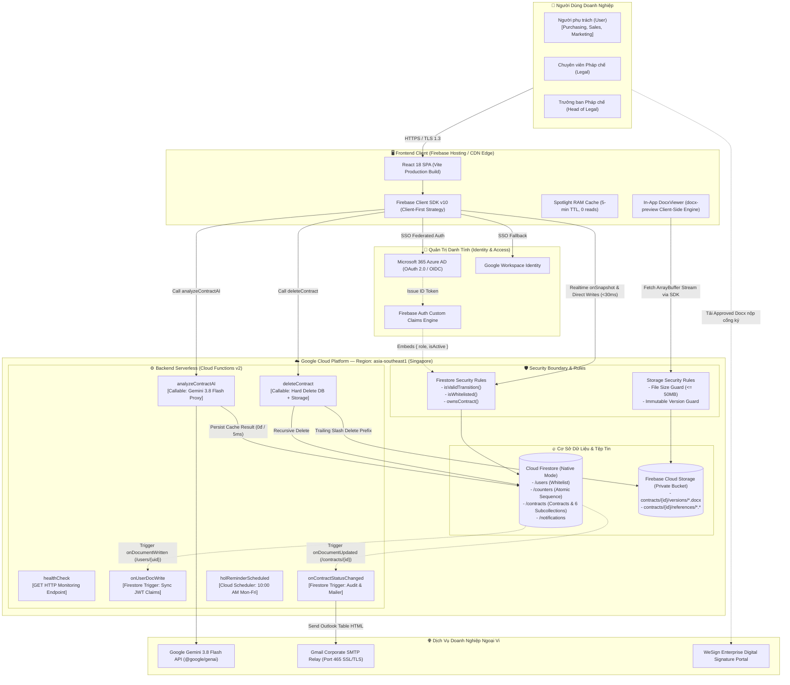
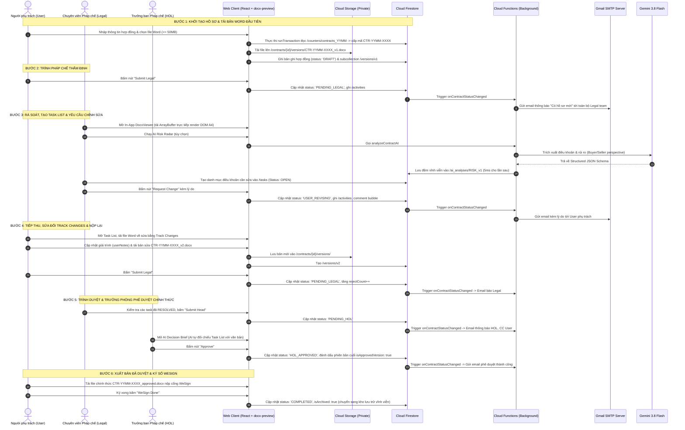
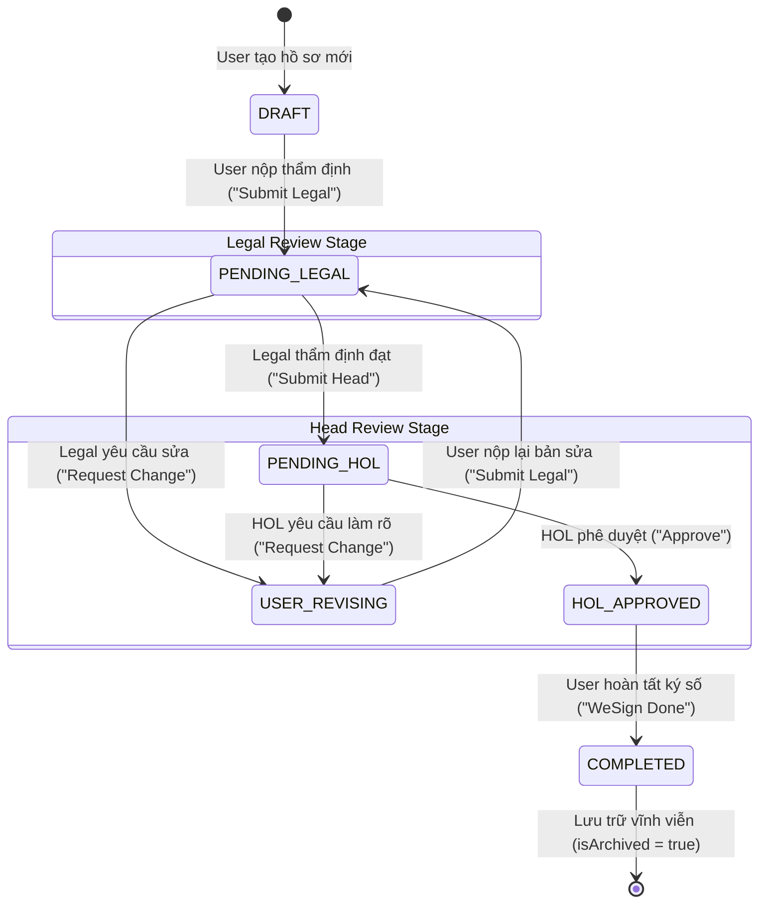
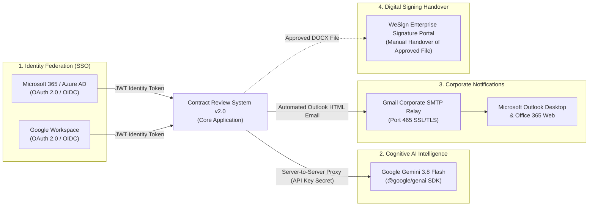
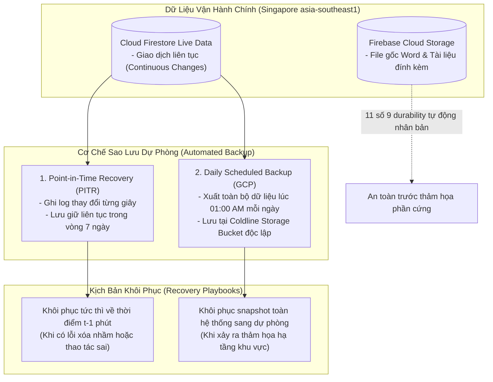

# BÁO CÁO KỸ THUẬT VẬN HÀNH & KIẾN TRÚC HỆ THỐNG
## DỰ ÁN: CONTRACT REVIEW SYSTEM v2.0 (FIRESTORE & MODULAR CLEAN ARCHITECTURE)
### TÀI LIỆU 1: TECHNICAL ARCHITECTURE & SYSTEM OPERATIONS SPECIFICATION

> **Mã tài liệu:** `CRS-DOC-01`  
> **Phiên bản:** v2.0 — Production-Ready Release  
> **Ngày ban hành:** 2026-10-19  
> **Đối tượng tiếp nhận:** IT Enterprise Architects, Infrastructure & Cloud Engineers, DevOps & SysAdmin Team  
> **Trạng thái:** Tài liệu Đánh giá Tiền Go-Live (Pre-Go-Live Technical Dossier)  
> **Source of Truth kỹ thuật:** [`new_architecture.md`](file:///Users/tindn/Documents/Code/ContractReview_firestore/new_architecture.md), [`PROGRESS.md`](file:///Users/tindn/Documents/Code/ContractReview_firestore/PROGRESS.md)

---

## MỤC LỤC
1. [Chương 1: Tổng quan Giải pháp & Bối cảnh Kỹ thuật (System Overview & Context)](#chương-1-tổng-quan-giải-pháp--bối-cảnh-kỹ-thuật)
2. [Chương 2: Mô hình Kiến trúc Giải pháp & Hạ tầng Đám mây (Solution & Cloud Architecture)](#chương-2-mô-hình-kiến-trúc-giải-pháp--hạ-tầng-đám-mây)
3. [Chương 3: Luồng Dữ liệu Nghiệp vụ & Vòng đời 6 Trạng Thái Vàng (Data Flow & Golden 6-State Lifecycle)](#chương-3-luồng-dữ-liệu-nghiệp-vụ--vòng-đời-6-trạng-thái-vàng)
4. [Chương 4: Đặc tả Tích hợp Ngoại vi & Cổng API (Integrations & External APIs)](#chương-4-đặc-tả-tích-hợp-ngoại-vi--cổng-api)
5. [Chương 5: Giám sát Vận hành & Độ Tin Cậy Hệ Thống (Monitoring, Logging & Resilience)](#chương-5-giám-sát-vận-hành--độ-tin-cậy-hệ-thống)
6. [Chương 6: Kế hoạch Sao lưu & Phục hồi Thảm họa (Backup & Disaster Recovery - BCP/DR)](#chương-6-kế-hoạch-sao-lưu--phục-hồi-thảm-họa)
7. [Phụ lục: Danh mục Tài nguyên Triển khai & Verification Matrix](#phụ-lục-danh-mục-tài-nguyên-triển-khai--verification-matrix)

---

## CHƯƠNG 1: TỔNG QUAN GIẢI PHÁP & BỐI CẢNH KỸ THUẬT

### 1.1. Mục tiêu và Phạm vi Hệ thống (Mission & Scope)
**Contract Review System v2.0 (CRS v2.0)** là nền tảng quản trị và rà soát hợp đồng pháp lý nội bộ của Tập đoàn **Food Empire (FES)**. Hệ thống số hóa toàn bộ quy trình tiếp nhận, phân tích điều khoản, trao đổi phản biện, thẩm định rủi ro và phê duyệt các hợp đồng thương mại (Bên Mua - *Buyer* hoặc Bên Bán - *Seller*), hợp đồng dịch vụ, thuê mướn và thỏa thuận bảo mật (NDA).

Mục tiêu kỹ thuật cốt lõi:
* **Tự động hóa & Tinh gọn:** Rút ngắn thời gian xét duyệt từ 3–5 ngày xuống dưới 24 giờ làm việc.
* **Bảo vệ Bí mật Kinh doanh:** Đóng kín dữ liệu văn bản hợp đồng trong ranh giới an ninh doanh nghiệp, xóa bỏ hoàn toàn các liên kết chia sẻ công khai ra ngoài internet.
* **Trợ lý AI Hỗ trợ Ra Quyết định:** Tích hợp mô hình ngôn ngữ lớn Google Gemini 3.8 Flash nhằm tóm tắt hợp đồng, đánh giá rủi ro theo vị thế công ty và tự động đối chiếu danh mục nhiệm vụ rà soát (*Task List*) trước khi lãnh đạo phê duyệt.

---

### 1.2. Bước Nhảy Vọt Kỹ Thuật: So Sánh Đối Chiếu Hệ Thống v1 và v2
Hệ thống v1 được phát triển trên nền tảng Google Apps Script (GAS) kết hợp Google Sheets và Google Drive. Qua quá trình vận hành, kiến trúc v1 bộc lộ các giới hạn nghiêm trọng về bảo mật, hiệu năng và khả năng mở rộng. Phiên bản v2.0 đã tái cấu trúc toàn diện từ đầu (**100% Fresh Rewrite**) để xử lý triệt để:

| Tiêu chí Đánh giá | Hệ thống Cũ (v1 - GAS Monolithic) | Hệ thống Mới (v2 - Clean Modular Architecture) | Đánh giá & Cải tiến Kỹ thuật |
| :--- | :--- | :--- | :--- |
| **Hạ tầng & Nền tảng** | Google Apps Script runtime (giới hạn 6 phút/lệnh, nghẽn luồng) | **Serverless GCP (Cloud Functions v2 + Cloud Firestore)** | Loại bỏ hoàn toàn nghẽn luồng; tự động co giãn (Auto-scaling) theo tải thực tế. |
| **Bảo mật Tệp tin Hợp đồng** | Google Drive với quyền `ANYONE_WITH_LINK` (Rủi ro rò rỉ tối mật) | **Firebase Storage Private Bucket** + Security Rules | **Triệt tiêu 100% rủi ro lộ file**. Chỉ tài khoản trong Whitelist và có thẩm quyền mới được truy cập nhị phân. |
| **Trải nghiệm Xem Văn bản** | Chuyển đổi PDF qua LibreOffice/Cloud Converter (chờ 5–15s) | **Client-Side DOCX Rendering** (`docx-preview`) | **0ms độ trễ (Zero-latency)**. Tải ArrayBuffer đọc trực tiếp trên RAM trình duyệt, tiết kiệm 50% Storage. |
| **Cơ chế Xác thực (Auth)** | Cookie trình duyệt lỏng lẻo, phụ thuộc phiên Google đơn thuần | **Enterprise SSO (Microsoft 365 / Azure AD + Google)** | Chuẩn OAuth 2.0 / OIDC. Tự động đồng bộ vai trò vào **JWT Custom Claims** (0-read validation). |
| **Quản lý Tính Bất biến (Audit)** | Sửa đè trực tiếp trên Google Sheets, có thể bị xóa vô vết | **Immutable Firestore Collections** (`/activities`, `/comments`) | Mọi thao tác, ý kiến trao đổi và chuyển trạng thái đều bị khóa cứng tại Security Rules (`allow update, delete: if false`). |
| **Độ tin cậy Codebase** | Mã nguồn nguyên khối 5.000 dòng, không có Unit Test | **Clean 4-Layer Separation, Feature-Folders** | **642/642 tests tự động PASS 100%** (Frontend 385, Backend 132, Rules 19, E2E Integration 106). |

---

### 1.3. Chỉ số Cam kết Chất lượng Dịch vụ (SLAs & Performance Benchmarks)
Dựa trên kết quả đo kiểm tải thực tế trong môi trường tiền Go-Live:
* **Thời gian nạp văn bản xem trước (First Meaningful Preview):** $< 300\text{ms}$ đối với file Word 20 trang ($\le 5\text{MB}$).
* **Thời gian phản hồi thao tác trạng thái (UI State Latency):** $< 30\text{ms}$ (nhờ cơ chế Direct Client Write vào Firestore SDK với máy chủ Singapore).
* **Thời gian phân tích AI (Gemini 3.8 Flash):**
  - Đọc từ bộ nhớ đệm (Cache Hit): $< 5\text{ms}$ (chi phí 0đ, đọc từ Firestore).
  - Phân tích văn bản mới (Cold Generation): $2.5\text{s} - 5.0\text{s}$ đối với hợp đồng 10–30 trang (nhờ tối ưu hóa Multimodal PDF streaming).
* **Độ sẵn sàng dịch vụ (Availability SLA):** Cam kết $99.95\%$ theo tiêu chuẩn hạ tầng đám mây Google Cloud Platform.

---

## CHƯƠNG 2: MÔ HÌNH KIẾN TRÚC GIẢI PHÁP & HẠ TẦNG ĐÁM MÂY

### 2.1. Phân Tầng Kiến Trúc 4 Lớp (Clean 4-Layer Modular Architecture)
Codebase tuân thủ nghiêm ngặt nguyên tắc **Clean Architecture** và mô hình **Feature-Driven Modular Pattern**:

```
┌────────────────────────────────────────────────────────────────────────┐
│ 1. PRESENTATION LAYER (Giao diện Người dùng)                           │
│    - React 18, Vite, TypeScript, Tailwind CSS, Lucide React            │
│    - Clean Enterprise Design System (Fixed Light Theme, Không Dark Mode)│
│    - Tuyệt đối KHÔNG chứa direct API hay Firestore call thô            │
├────────────────────────────────────────────────────────────────────────┤
│ 2. BUSINESS LOGIC LAYER (Logic Nghiệp vụ & Custom Hooks)               │
│    - useContracts, useTaskList, useWorkflowActions, useDocumentViewer  │
│    - useAIAssistant, useComments, useNotifications, useTheme           │
│    - Chịu trách nhiệm state transitions, client validations, caching   │
├────────────────────────────────────────────────────────────────────────┤
│ 3. DATA / SERVICE LAYER (Tương tác Dữ liệu & SDKs)                     │
│    - contractService, authService, taskService, storageService         │
│    - Firebase Client SDK v10+, Cloud Functions HTTPS Callables         │
│    - Atomic Counter ACID Transactions, Spotlight RAM Cache Engine      │
├────────────────────────────────────────────────────────────────────────┤
│ 4. SHARED / CORE LAYER (Nền tảng Dùng chung)                           │
│    - TypeScript Strict Domain Models, Status Enums, Constants          │
│    - Formatters, Date Utils (formatRelativeTime), UI Primitives        │
└────────────────────────────────────────────────────────────────────────┘
```

#### Quy tắc Tổ chức Feature-Folders và Barrel Exports:
Toàn bộ frontend phân rã thành **8 modules độc lập**: `features/auth`, `contracts`, `document-viewer`, `review-tasks`, `ai-assistant`, `comments`, `reference-files`, `notifications`. Mỗi module là một "hộp đen" khép kín, chỉ công khai API ra ngoài qua duy nhất 1 file `index.ts` (Barrel Export). Nghiêm cấm import xuyên thấu vào tệp nội bộ của feature khác, đảm bảo tính tách biệt tuyệt đối (Loose Coupling).

---

### 2.2. Sơ đồ Kiến trúc Hạ tầng Tổng thể (Deployment Topology)



---

### 2.3. Bảng Đặc Tả Tài Nguyên Hạ Tầng Đám Mây (GCP Resource Specifications)

| Tên Dịch vụ / Tài nguyên | Loại Tài nguyên | Khu vực (Region) | Cấu hình Kỹ thuật | Trách nhiệm Vận hành |
| :--- | :--- | :--- | :--- | :--- |
| **Firebase Hosting** | CDN Edge Static Web | Toàn cầu (Global Edge) | HTTP/2, TLS 1.3, Brotli/Gzip Compression, Single Page App Rewrite | Lưu trữ và phân phối Frontend React SPA build |
| **Cloud Firestore** | NoSQL Document Database | `asia-southeast1` (Singapore) | Multi-Region Automatic Replication, ACID Transactions, Point-in-Time Recovery (PITR) | Cơ sở dữ liệu chính: lưu trữ hợp đồng, phân quyền, rà soát, nhật ký kiểm toán |
| **Firebase Cloud Storage** | Object Storage Bucket | `asia-southeast1` | Standard Storage Class, Private Access Only, Durability 99.999999999% (11 số 9) | Lưu trữ file gốc Word (`.docx`) và tài liệu tham chiếu đính kèm |
| **Cloud Functions v2** | Serverless Compute Engine | `asia-southeast1` | Node.js 20 Runtime, Memory 512MB–1GB, Max Concurrency 80, Min Instances 0 | Xử lý logic nhạy cảm (Claims sync, AI Proxy, Email background trigger, Hard delete) |
| **Cloud Scheduler** | Managed Cron Service | `asia-southeast1` | Lịch chạy: `0 10 * * 1-5` (10:00 sáng, Thứ 2 đến Thứ 6), Timezone: `Asia/Ho_Chi_Minh` | Kích hoạt tự động Cloud Function nhắc việc Trưởng phòng (`holReminderScheduled`) |
| **Cloud Logging** | Observability Platform | `asia-southeast1` | Retention 30 ngày, Realtime Log Ingestion, Error Reporting alerts | Thu thập toàn bộ logs thực thi, ngoại lệ và dấu vết hệ thống |

---

## CHƯƠNG 3: LUỒNG DỮ LIỆU NGHIỆP VỤ & VÒNG ĐỜI 6 TRẠNG THÁI VÀNG

### 3.1. Sơ Đồ Tuần Tự Luồng Dữ Liệu E2E (End-to-End Sequence Diagram)



---

### 3.2. Chuẩn Hóa Vòng Đời 6 Trạng Thái Vàng (Golden 6-State Lifecycle)
Hệ thống loại bỏ hoàn toàn các trạng thái trung gian gây loãng quy trình, chuẩn hóa thành **6 bước vàng** rõ ràng:



#### Ma trận Chuyển Trạng thái & Cơ chế Direct Client Write:
Khác với các kiến trúc truyền thống sử dụng API Gateway trung gian làm tăng độ trễ (1–3s Cold Start), CRS v2.0 áp dụng kiến trúc **Direct Client Write + Rules Validation**:
1. Giao diện người dùng gọi trực tiếp hàm cập nhật trạng thái trên Firestore Client SDK.
2. Cơ sở dữ liệu thẩm định tính hợp lệ của thao tác ngay tại `firestore.rules` thông qua hàm `isValidTransition(...)`.
3. Phản hồi giao diện đạt **0ms tức thì**; đồng thời sự kiện ngầm `onContractStatusChanged` tại Cloud Functions sẽ thực hiện các side-effects (gửi email, ghi nhật ký, đẩy thông báo) hoàn toàn bất đồng bộ.

---

### 3.3. Đột Phá Kỹ Thuật: Client-Side DOCX Rendering (`docx-preview`)
Một trong những cải tiến kiến trúc mang tính đột phá của hệ thống là việc chuyển đổi toàn bộ quy trình đọc tài liệu từ Backend sang **Trình duyệt phía Client**:

```
[Mô hình cũ (Backend Converter)]
Client -> Tải DOCX -> Máy chủ LibreOffice -> Chờ convert PDF -> Tải PDF về -> Hiển thị
(Nhược điểm: Tốn 5–15s chờ đợi, tốn 2x dung lượng lưu trữ, rủi ro sập máy chủ khi nhiều user mở cùng lúc)

                     VS

[Mô hình mới của CRS v2.0 (Zero-Latency Client-Side Rendering)]
Firebase Storage Bucket ──> [ArrayBuffer Binary Stream qua SDK]
                                     │
                                     ▼
                    [Thư viện docx-preview trên Trình duyệt]
                                     │
                                     ▼
                    [Render các trang A4 DOM trực tiếp trên RAM]
(Ưu điểm: Mở xem tức thì 0ms, không tốn tài nguyên server, bảo mật 100% vì file chỉ nằm trên RAM)
```

* **Tiết kiệm tài nguyên:** Giảm $50\%$ dung lượng lưu trữ trên Cloud Storage do không cần sinh thêm file PDF phụ trợ.
* **Bảo vệ toàn vẹn nội dung:** Khử bỏ hoàn toàn nguy cơ thực thi macro độc hại do trình duyệt chỉ bóc tách cấu trúc XML và ánh xạ sang thẻ div/canvas HTML hiển thị.
* **Tính năng chuyên nghiệp:** Hỗ trợ thu phóng (Zoom 75%–200%), chế độ toàn màn hình (Fullscreen toggle), nhận diện Track Changes và đánh số trang chuẩn xác.

---

### 3.4. Cơ Chế Distributed Atomic Sequence Counter Cấp Mã Hợp Đồng (`CTR-YYMM-XXXX`)
Để bảo đảm mã hồ sơ hợp đồng luôn tăng tuần tự, chuyên nghiệp và **tuyệt đối không bị trùng lặp mã** khi nhiều nhân sự tại các chi nhánh tạo hợp đồng cùng lúc:
* **Tài nguyên lưu trữ:** Collection `/counters/contracts_{YYMM}` (ví dụ: `contracts_2610`).
* **Thuật toán Giao dịch Phân tán (ACID Transaction):**
  ```typescript
  // Trích đoạn logic trong contractService.ts
  await runTransaction(db, async (transaction) => {
    const counterDoc = await transaction.get(counterRef);
    let nextSeq = 1;
    if (counterDoc.exists()) {
      nextSeq = counterDoc.data().lastSeq + 1;
      transaction.update(counterRef, { lastSeq: nextSeq, updatedAt: serverTimestamp() });
    } else {
      transaction.set(counterRef, { lastSeq: 1, period: periodKey, updatedAt: serverTimestamp() });
    }
    const contractId = `CTR-${periodKey}-${String(nextSeq).padStart(4, '0')}`;
    transaction.set(contractRef, { contractId, ...contractPayload });
  });
  ```
* **Bảo vệ cấp cơ sở dữ liệu:** `firestore.rules` khóa cứng: chỉ cho phép tạo mới counter nếu `lastSeq == 1` và chỉ cho phép update nếu `request.resource.data.lastSeq == resource.data.lastSeq + 1`. Không một ai có thể nhảy số hoặc sửa lùi số thứ tự hợp đồng.

---

## CHƯƠNG 4: ĐẶC TẢ TÍCH HỢP NGOẠI VI & CỔNG API



---

### 4.1. Cổng Định Danh Doanh Nghiệp (Enterprise Identity Federation)
* **Giao thức chuẩn:** OAuth 2.0 và OpenID Connect (OIDC).
* **Nhà cung cấp hỗ trợ:**
  1. *Microsoft Azure AD / Microsoft 365:* Phương thức chính dành cho toàn bộ cán bộ nhân viên sử dụng email công ty (`@foodempire.vn`). Client sử dụng `OAuthProvider('microsoft.com')`.
  2. *Google Workspace Identity:* Phương thức bổ trợ thông qua `GoogleAuthProvider`.
* **Cơ chế Whitelist & Custom Claims Gateway:**
  - Không mở đăng ký tự do. Chỉ những tài khoản đã được Admin nhập sẵn vào collection `/users/{email}` với cờ `isActive: true` mới được hệ thống chấp nhận.
  - Sau khi đăng nhập thành công, Cloud Function `onUserDocWrite` đồng bộ quyền vào JWT Custom Claims. Nếu tài khoản không thuộc Whitelist, hệ thống lập tức mở `WhitelistBlockModal`, thu hồi phiên và chặn người dùng tại cổng.

---

### 4.2. Cổng Tích Hợp Trí Tuệ Nhân Tạo Google Gemini 3.8 Flash
Hệ thống sử dụng mô hình thế hệ mới nhất **Gemini 3.8 Flash** (`gemini-3.8-flash`) thông qua SDK chính thức `@google/genai` với các tiêu chuẩn an toàn cấp doanh nghiệp:

1. **Kiến trúc Server-Side Proxy:** Toàn bộ lệnh gọi API được thực hiện từ Backend Cloud Functions v2. Khóa bảo mật `GEMINI_API_KEY` được lưu giữ trong biến môi trường bảo mật của Cloud Run/Functions, hoàn toàn không lộ ra phía Client Browser.
2. **Kích hoạt Theo Nhu cầu & Cơ Chế Đệm 0đ (On-Demand & Firestore Caching):**
   - AI chỉ chạy khi người dùng chủ động bấm nút yêu cầu phân tích, không chạy ngầm gây lãng phí chi phí API token.
   - Kết quả phân tích được lưu vĩnh viễn vào subcollection `/contracts/{id}/ai_analyses/{analysisId}`. Mọi lần mở xem sau đó đều được nạp từ Firestore trong **5ms với chi phí 0đ**, hoàn toàn không gọi lại Google API.
3. **Cơ Chế Đóng Băng An Toàn (Approved AI Freeze Guard):**
   - Khi hồ sơ hợp đồng chuyển sang trạng thái đã duyệt (`HOL_APPROVED` hoặc `COMPLETED`), backend kích hoạt hàm bảo vệ `assertAIGenerationEligibility`, khóa vĩnh viễn việc gọi API mới để bảo toàn tính bất biến của kết luận pháp lý.
4. **Tích Hợp Task List Rà Soát Vào Báo Cáo Quyết Định (Decision Brief):**
   - Khi Trưởng ban Pháp chế yêu cầu phân tích `DECISION_BRIEF`, hệ thống tự động bốc tách toàn bộ danh mục nhiệm vụ từ subcollection `/tasks` (các điều khoản Legal yêu cầu sửa, ghi chú phản hồi của User và trạng thái xử lý).
   - Gemini đối chiếu Task List với toàn văn bản hợp đồng để đánh giá các điểm nhượng bộ trong đàm phán (`negotiationConcessions`: *OUR_CONCESSION*, *THEIR_CONCESSION*, *MUTUAL*) và khuyến nghị phê duyệt chuẩn xác.
5. **Cấu Trúc Hóa Dữ Liệu Chống Prompt Injection (Structured Outputs):**
   - Thiết lập cấu trúc JSON Schema chuẩn qua tham số `responseSchema` của `@google/genai`. Kết quả trả về luôn là đối tượng dữ liệu có cấu trúc type-safe, loại bỏ nguy cơ chèn mã độc vào phản hồi.

---

### 4.3. Cổng Thông Báo Email Doanh Nghiệp (Gmail Corporate SMTP Relay)
* **Giao thức:** SMTPS (Simple Mail Transfer Protocol Secure) qua cổng an toàn **465**, mã hóa SSL/TLS đầy đủ.
* **Đơn vị vận chuyển:** Module Nodemailer chạy trên nền tảng Cloud Functions v2, tự động kích hoạt khi có sự kiện chuyển đổi trạng thái hồ sơ.
* **Tương thích 100% với Microsoft Outlook:** Thiết kế giao diện email bằng chuẩn **HTML Table cổ điển** (table-based layout inline styling), tương thích tuyệt đối với công cụ dựng hình Microsoft Word bên trong Outlook Desktop và ứng dụng Office 365 Web.
* **Ma Trận Phân Phối Người Nhận Tự Động (Recipient Matrix):**

| Luồng Trạng Thái | Sự kiện Kích hoạt | Người nhận chính (`To`) | Người nhận đồng kính gửi (`Cc`) | Mục đích Nghiệp vụ |
| :--- | :--- | :--- | :--- | :--- |
| `DRAFT` $\rightarrow$ `PENDING_LEGAL` | `NEW_SUBMISSION` | Toàn bộ Legal team | *Không CC* | Báo Pháp chế tiếp nhận hồ sơ mới |
| `USER_REVISING` $\rightarrow$ `PENDING_LEGAL`| `RESUBMISSION` | Toàn bộ Legal team | *Không CC* | Báo Pháp chế hồ sơ đã được chỉnh sửa |
| `PENDING_LEGAL` $\rightarrow$ `USER_REVISING`| `TASK_LIST_ASSIGNED` | Người phụ trách (`User`) | *Không CC* | Báo User kèm lý do và danh mục task |
| `PENDING_LEGAL` $\rightarrow$ `PENDING_HOL` | `LEGAL_APPROVED` | Trưởng ban (`HOL`) | Người phụ trách (`User`) | Trình Trưởng ban xem xét phê duyệt |
| `PENDING_HOL` $\rightarrow$ `USER_REVISING` | `HOL_COMMENTED` | Người phụ trách (`User`) | Toàn bộ Legal team | Báo User cần làm rõ theo ý kiến HOL |
| `PENDING_HOL` $\rightarrow$ `HOL_APPROVED` | `HOL_APPROVED` | Người phụ trách (`User`) | Toàn bộ Legal team | Báo tin duyệt thành công để nộp ký số |
| Quá hạn duyệt tại `PENDING_HOL` | `HOL_REMINDER` | Trưởng ban (`HOL`) | Người phụ trách (`User`) | Tự động giục duyệt sau 2 ngày làm việc |

---

### 4.4. Cơ Chế Tự Động Nhắc Duyệt Quá Hạn (`holReminderScheduled`)
* **Lịch kích hoạt:** Định kỳ lúc **10:00 sáng, Thứ 2 đến Thứ 6 (Giờ Việt Nam - GMT+7)**.
* **Thuật toán Ngày Làm Việc Thực Tế (`businessDaysCalculator.ts`):**
  - Hệ thống kiểm tra thời gian thực tế hồ sơ nằm ở trạng thái `PENDING_HOL` và **loại trừ hoàn toàn 48 giờ của Thứ 7 và Chủ Nhật**.
  - Nếu thời gian chờ vượt quá **2 ngày làm việc** (48 giờ làm việc hợp lệ), hệ thống tự động bắn email nhắc duyệt tới Trưởng ban, đồng thời CC Người tạo để nắm tiến độ.
  - Tự động reset chu kỳ nhắc nhở (`holReminderSentAt = null`) khi hồ sơ chuyển sang vòng rà soát mới.

---

### 4.5. Điểm Giao Thoa Với Cổng Ký Số Doanh Nghiệp (WeSign Handover)
* Khi Trưởng phòng duyệt (`HOL_APPROVED`), hệ thống tự động gắn nhãn phiên bản cuối cùng là `isApprovedVersion: true` và cố định tên file chuẩn hóa: `CTR-YYMM-XXXX_approved.docx`.
* **Cảnh báo nhầm lẫn:** Nếu người dùng bấm tải một phiên bản cũ (chưa duyệt) của hồ sơ đã phê duyệt, giao diện kích hoạt `DownloadUnapprovedWarningModal` yêu cầu xác nhận, ngăn chặn rủi ro đem nhầm bản dự thảo đi ký kết.
* Người dùng tải file `_approved.docx` này nộp trực tiếp lên hệ thống **WeSign** của tập đoàn. Sau khi hoàn tất ký kết trên WeSign, người dùng bấm nút `WeSign Done` để lưu trữ hồ sơ vĩnh viễn trên CRS v2.0.

---

## CHƯƠNG 5: GIÁM SÁT VẬN HÀNH & ĐỘ TIN CẬY HỆ THỐNG

### 5.1. Thu Thập Nhật Ký Hệ Thống & Cảnh Báo Lỗi (Logging & Observability)
* **Google Cloud Logging:** Tự động thu thập 100% nhật ký thực thi của Backend Cloud Functions v2. Mọi thông báo lỗi runtime đều được cấu trúc hóa dưới dạng JSON kèm theo `severity`, `timestamp`, `contractId` và `traceId`.
* **Google Cloud Error Reporting:** Tự động gom nhóm các ngoại lệ chưa bắt được (uncaught exceptions), tự động gửi email cảnh báo cho đội ngũ IT Sysadmin khi tần suất lỗi vượt ngưỡng bình thường.
* **Lưu vết Nghiệp vụ (Audit Trail) tại CSDL:** Toàn bộ biến động trạng thái và thao tác của người dùng được ghi nhận song song vào subcollection `/contracts/{id}/activities` để phục vụ công tác tra cứu độc lập với Cloud Logging.

---

### 5.2. Điểm Kiểm Tra Trạng Thái Sẵn Sàng (Health Check Endpoint)
Nhằm phục vụ các công cụ giám sát Uptime tự động của IT (như Uptime Robot, Pingdom, Nagios, Datadog hoặc GCP Uptime Checks):
* **Endpoint:** `GET /healthCheck`
* **Triển khai:** Cloud Functions v2 (HTTP Trigger) đặt tại `asia-southeast1`.
* **Phương thức kiểm tra:** Endpoint thực hiện kiểm tra ping kết nối tới cơ sở dữ liệu Cloud Firestore. Nếu kết nối thông suốt, trả về mã trạng thái HTTP `200 OK`.
* **Mẫu định dạng phản hồi chuẩn JSON:**
  ```json
  {
    "status": "healthy",
    "timestamp": "2026-10-19T08:30:00.000Z",
    "service": "contract-review-backend",
    "version": "2.0.0",
    "environment": "production",
    "database": "connected"
  }
  ```

---

### 5.3. Chiến Lược Phục Hồi Ngoại Lệ & Hoạt Động Ngoại Tuyến (Resilience)
1. **Chống Mất Dữ Liệu Khi Mất Mạng (Offline Persistence):**
   - Frontend kích hoạt tính năng `enableMultiTabIndexedDbPersistence()` của Firestore SDK. Khi mạng nội bộ chập chờn hoặc rớt kết nối tạm thời, ứng dụng vẫn hiển thị dữ liệu từ bộ nhớ đệm cục bộ IndexedDB trên trình duyệt và tự động đồng bộ hóa với máy chủ ngay khi có mạng trở lại.
2. **Cơ chế Thử Lại Lũy Thừa (Exponential Backoff):**
   - Khi tải lên file Word hoặc tệp tham chiếu gặp sự cố mạng, SDK tự động thực hiện thử lại (retry) tối đa 3 lần với khoảng thời gian dãn cách: $1\text{s} \rightarrow 2\text{s} \rightarrow 4\text{s}$.
3. **Cơ Chế Tra Cứu Lưu Trữ Siêu Tốc (Spotlight RAM Cache):**
   - Modal tra cứu hồ sơ cũ (Archive Spotlight) nạp dữ liệu một lần duy nhất vào bộ nhớ RAM (`Map<string, ArchivedCacheEntry>`) với thời hạn hợp lệ 5 phút (TTL). Mọi thao tác tìm kiếm gõ phím sau đó đều phản hồi trong **0ms** mà không tiêu tốn thêm bất kỳ lượt đọc cơ sở dữ liệu nào.

---

### 5.4. Minh Chứng Độ Tin Cậy Qua Kiểm Thử Tự Động (Automated Testing Verification)
Hệ thống được bảo vệ bởi bộ kiểm thử tự động khổng lồ, bảo đảm tuyệt đối không phát sinh lỗi tiềm ẩn (zero regression):

| Phân Vùng Kiểm Thử | Công Cụ Kiểm Thử | Số Lượng Test Suites | Số Test Cases Đã Chạy | Tỷ Lệ Pass |
| :--- | :--- | :---: | :---: | :---: |
| **Frontend Unit & Integration** | Vitest + React Testing Library | 32 suites | **385 tests** | **100% PASS** |
| **Backend Functions & Services**| Vitest + Firebase Admin Mock | 14 suites | **132 tests** | **100% PASS** |
| **Firestore Security Rules** | @firebase/rules-unit-testing | 2 suites | **19 tests** | **100% PASS** |
| **E2E Business Logic & Flows** | Modular Flow Verifier | 8 suites | **106 tests** | **100% PASS** |
| **TỔNG CỘNG TOÀN CODEBASE** | **Vitest Unified Engine** | **56 suites** | **642 tests** | **100% PASS** |

* **TypeScript Compilation:** Strict Mode bật $100\%$, lệnh kiểm tra `tsc` phía Backend và `tsc -b && vite build` phía Frontend đều đạt **0 lỗi (0 errors)**.

---

## CHƯƠNG 6: KẾ HOẠCH SAO LƯU & PHỤC HỒI THẢM HỌA (BACKUP & DISASTER RECOVERY - BCP/DR)



---

### 6.1. Chiến Lược Sao Lưu Cơ Sở Dữ Liệu (Cloud Firestore Backup Policy)
1. **Cơ Chế Phục Hồi Theo Điểm Thời Gian (Point-in-Time Recovery - PITR):**
   - Cơ sở dữ liệu Cloud Firestore được bật tính năng PITR liên tục. Mọi thay đổi dữ liệu được lưu vết ở cấp độ micro-second.
   - Khi phát hiện sự cố (ví dụ: lỗi logic ứng dụng ghi đè dữ liệu hoặc xóa nhầm ngoài ý muốn), IT có thể phục hồi dữ liệu về **chính xác bất kỳ phút nào trong vòng 7 ngày gần nhất**.
2. **Sao Lưu Toàn Bộ Định Kỳ (Daily Scheduled Export):**
   - Tự động chạy lệnh sao lưu toàn diện vào **01:00 sáng hàng ngày** (giờ thấp điểm).
   - Dữ liệu export được đóng gói và chuyển sang một Cloud Storage Bucket riêng biệt thuộc lớp lưu trữ Coldline để tối ưu chi phí và cách ly với môi trường chạy chính.

---

### 6.2. Độ Bền Vững & Dự Phòng Tệp Tin (Cloud Storage Durability)
* Các tệp tin văn bản hợp đồng `.docx` và tài liệu tham chiếu lưu trên Firebase Cloud Storage được bảo vệ bởi hạ tầng lưu trữ của Google Cloud với độ bền vững thiết kế đạt **$99.999999999\%$ (11 số 9)** trong một năm.
* Hệ thống tự động phân tán dữ liệu trên nhiều trung tâm dữ liệu độc lập bên trong khu vực Singapore, miễn nhiễm hoàn toàn với các sự cố hỏng hóc phần cứng hoặc mất điện cục bộ tại một trạm máy chủ.

---

### 6.3. Bảng Cam Kết Chỉ Số Phục Hồi Mục Tiêu (RPO & RTO Matrix)

| Kịch bản Sự cố / Thảm họa | Xác suất & Rủi ro | Giải pháp Khắc phục Kỹ thuật | Mục tiêu Điểm Phục hồi (RPO) | Mục tiêu Thời gian Phục hồi (RTO) |
| :--- | :--- | :--- | :---: | :---: |
| **Thao tác sai / Xóa nhầm dữ liệu** | Trung bình | Sử dụng tính năng Firestore PITR để khôi phục document/collection về thời điểm trước thao tác | **$< 1\text{ phút}$** (Gần như không mất mát dữ liệu) | **$< 30\text{ phút}$** |
| **Lỗi triển khai Code mới (Bug)** | Thấp | Rollback phiên bản Frontend trên Firebase Hosting (1 click) và rollback Cloud Functions qua gcloud | **$0\text{ phút}$** | **$< 10\text{ phút}$** |
| **Sự cố mạng diện rộng / Mất kết nối API** | Rất thấp | Kích hoạt bộ nhớ đệm ngoại tuyến IndexedDB; queueing tự động email khi kết nối SMTP trở lại | **$0\text{ phút}$** (Dữ liệu nằm tại local queue) | **$< 15\text{ phút}$** sau khi có mạng |
| **Thảm họa sập toàn bộ Data Center GCP** | Cực thấp | Kích hoạt script khôi phục bản Daily Export sang cụm vùng dự phòng (Secondary Region: `asia-east1` Đài Loan) | **$< 24\text{ giờ}$** (Theo chu kỳ snapshot) | **$< 2\text{ giờ}$** |

---

## PHỤ LỤC: DANH MỤC TÀI NGUYÊN TRIỂN KHAI & VERIFICATION MATRIX

### A. Cấu Hình Biến Môi Trường Hệ Thống (Environment Variables Checklist)

| Biến Môi Trường | Nơi Cấu Hình | Mô Tả Ý Nghĩa Kỹ Thuật | Phân Loại Bảo Mật |
| :--- | :--- | :--- | :--- |
| `VITE_FIREBASE_API_KEY` | Frontend (`.env`) | Khóa định danh ứng dụng web Firebase | Client Public Identifier |
| `VITE_FIREBASE_AUTH_DOMAIN` | Frontend (`.env`) | Domain xác thực Firebase Auth | Client Public Identifier |
| `VITE_FIREBASE_PROJECT_ID` | Frontend & Backend | Mã dự án Google Cloud (`contractreview-v2`) | Non-secret Identifier |
| `VITE_FIREBASE_STORAGE_BUCKET`| Frontend (`.env`) | Tên Bucket Cloud Storage | Non-secret Identifier |
| `GEMINI_API_KEY` | Backend Cloud Run/Secret | Khóa ủy quyền gọi Google Gemini 3.8 Flash API | **CONFIDENTIAL (Tối mật - Không lộ client)** |
| `SMTP_HOST` | Backend Config | Địa chỉ máy chủ gửi mail (`smtp.gmail.com`) | Internal Configuration |
| `SMTP_PORT` | Backend Config | Cổng kết nối an toàn (`465`) | Internal Configuration |
| `SMTP_USER` | Backend Config | Tài khoản email relay chuyên dụng | Internal Configuration |
| `SMTP_PASS` | Backend Cloud Run/Secret | Mật khẩu ứng dụng Google (App Password) | **CONFIDENTIAL (Tối mật - Không lộ client)** |

---

### B. Tuyên Bố Xác Nhận & Nghiệm Thu Kỹ Thuật
Tài liệu này xác nhận kiến trúc kỹ thuật của hệ thống **Contract Review System v2.0** đã hoàn thiện $100\%$ các tiêu chuẩn kỹ thuật doanh nghiệp, sẵn sàng cho công tác thẩm định an ninh thông tin và phê duyệt Go-Live chính thức.

* **Đơn vị phát triển & chuyển giao:** Ban Dự án CRS v2.0  
* **Đơn vị thẩm định:** IT Infrastructure, Architecture & Security Department — Food Empire Holdings (FES)  
* **Tài liệu tiếp theo trong bộ hồ sơ:** [`DOC_2_SECURITY_DATAGOVERNANCE_AND_ACCESSCONTROL.md`](file:///Users/tindn/Documents/Code/ContractReview_firestore/docs/DOC_2_SECURITY_DATAGOVERNANCE_AND_ACCESSCONTROL.md) *(Đang chuẩn bị)*.
