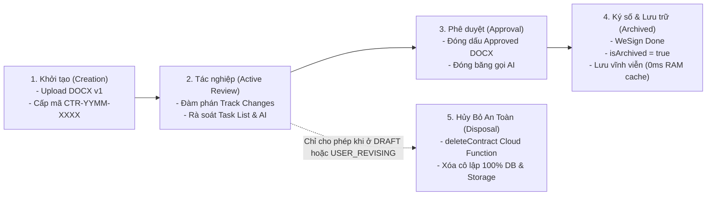
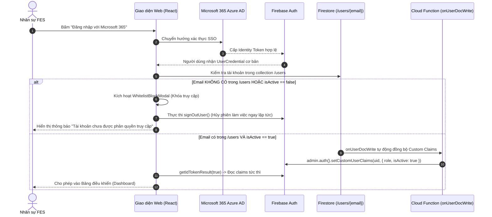
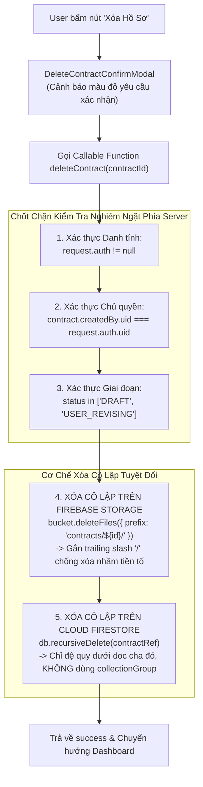
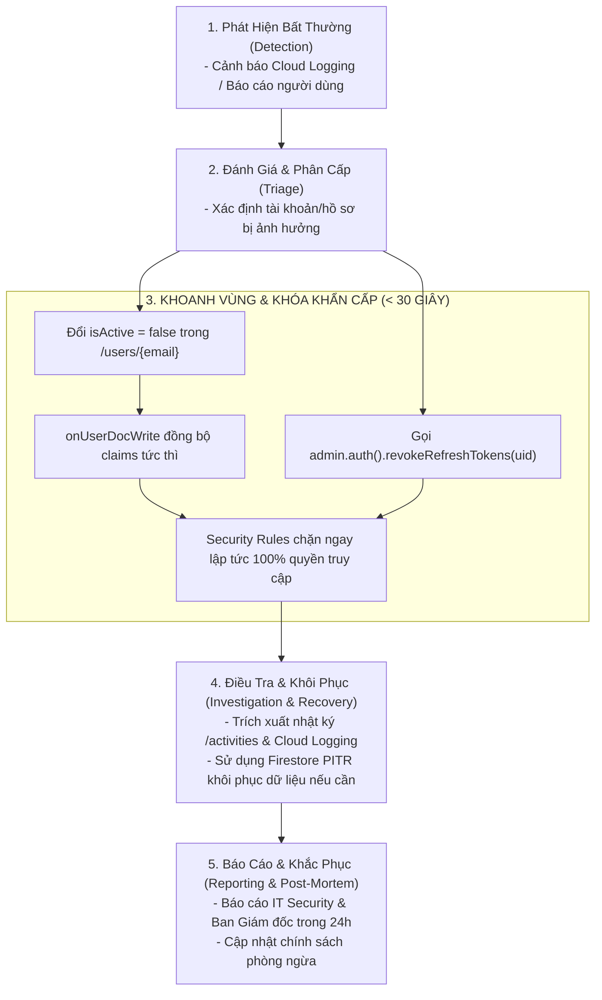

# BÁO CÁO KỸ THUẬT AN TOÀN THÔNG TIN & QUẢN TRỊ DỮ LIỆU
## DỰ ÁN: CONTRACT REVIEW SYSTEM v2.0 (FIRESTORE & MODULAR CLEAN ARCHITECTURE)
### TÀI LIỆU 2: SECURITY, DATA GOVERNANCE & ACCESS CONTROL SPECIFICATION

> **Mã tài liệu:** `CRS-DOC-02`  
> **Phiên bản:** v2.0 — Production-Ready Release  
> **Ngày ban hành:** 2026-10-19  
> **Đối tượng tiếp nhận:** IT Security (InfoSec / SecOps / CISO), Data Governance & Compliance Team, Data Protection Officer (DPO), Legal Operations  
> **Trạng thái:** Tài liệu Đánh giá Tiền Go-Live (Pre-Go-Live Security & Governance Dossier)  
> **Tài liệu tham chiếu:** [`DOC_1_TECHNICAL_ARCHITECTURE_AND_OPERATIONS.md`](file:///Users/tindn/Documents/Code/ContractReview_firestore/docs/DOC_1_TECHNICAL_ARCHITECTURE_AND_OPERATIONS.md), [`new_architecture.md`](file:///Users/tindn/Documents/Code/ContractReview_firestore/new_architecture.md)

---

## MỤC LỤC
1. [Chương 1: Khung Quản Trị & Phân Loại Dữ Liệu (Data Governance & Classification Framework)](#chương-1-khung-quản-trị--phân-loại-dữ-liệu)
2. [Chương 2: Quản Trị Danh Tính & Kiểm Soát Truy Cập (IAM & Access Control)](#chương-2-quản-trị-danh-tính--kiểm-soát-truy-cập)
3. [Chương 3: Quy Tắc An Ninh Cấp Cơ Sở Dữ Liệu & Lưu Trữ (Database & Storage Security Rules)](#chương-3-quy-tắc-an-ninh-cấp-cơ-sở-dữ-liệu--lưu-trữ)
4. [Chương 4: Cơ Chế Xóa Dữ Liệu An Toàn & Quyền Được Hủy Bỏ (Safe Data Disposal & Hard Deletion Policy)](#chương-4-cơ-chế-xóa-dữ-liệu-an-toàn--quyền-được-hủy-bỏ)
5. [Chương 5: Tiêu Chuẩn Mã Hóa, Mô Hình Mối Đe Dọa & Bảo Mật Ứng Dụng (Encryption, Threat Model & AppSec)](#chương-5-tiêu-chuẩn-mã-hóa-mô-hình-mối-đe-dọa--bảo-mật-ứng-dụng)
6. [Chương 6: Kế Hoạch Ứng Phó Sự Cố An Ninh & Vi Phạm Dữ Liệu (Incident Response & Data Breach Playbook)](#chương-6-kế-hoạch-ứng-phó-sự-cố-an-ninh--vi-phạm-dữ-liệu)
7. [Phụ lục: Ma Trận Đối Soát Tuân Thủ An Toàn Thông Tin (Compliance Checklist)](#phụ-lục-ma-trận-đối-soát-tuân-thủ-an-toàn-thông-tin)

---

## CHƯƠNG 1: KHUNG QUẢN TRỊ & PHÂN LOẠI DỮ LIỆU

### 1.1. Ma Trận Phân Loại Dữ Liệu Doanh Nghiệp (Data Classification Matrix)
Để bảo đảm dữ liệu được áp dụng các biện pháp kiểm soát tương xứng với mức độ rủi ro, hệ thống phân loại toàn bộ tài sản thông tin thành **3 cấp độ**:

| Cấp độ Phân loại | Định nghĩa & Phạm vi Dữ liệu | Tài sản Cụ thể trong Hệ thống | Mức độ Ảnh hưởng khi Thất thoát | Cơ chế Kiểm soát Bắt buộc |
| :--- | :--- | :--- | :---: | :--- |
| **C1: Confidential / Restricted** *(Tối mật / Giới hạn)* | Dữ liệu nhạy cảm cao nhất của tập đoàn, ảnh hưởng trực tiếp đến cam kết pháp lý, tài chính và lợi thế cạnh tranh. | - Toàn văn hợp đồng (`.docx`)<br>- Giá trị thanh toán, tiến độ giải ngân<br>- Tài liệu tham chiếu, phụ lục mật<br>- Báo cáo rủi ro pháp lý (`/ai_analyses`)<br>- Nhiệm vụ rà soát rủi ro (`/tasks`) | **NGHIÊM TRỌNG**<br>(Tranh chấp pháp lý, phạt vi phạm hợp đồng, lộ bí mật kinh doanh) | - **Data Isolation:** User chỉ xem hợp đồng do mình tạo.<br>- Private Cloud Storage Bucket.<br>- Mã hóa AES-256 at-rest.<br>- Khóa tải phiên bản cũ chưa duyệt.<br>- Chỉ cấp quyền qua Whitelist. |
| **C2: Internal** *(Lưu hành nội bộ)* | Dữ liệu phục vụ vận hành, trao đổi nghiệp vụ và kiểm soát quy trình nội bộ giữa các phòng ban. | - Danh bạ phân quyền (`/users`)<br>- Lịch sử thao tác (`/activities`)<br>- Kênh trao đổi phản biện (`/comments`)<br>- Số liệu thống kê Dashboard | **TRUNG BÌNH**<br>(Gián đoạn quy trình nội bộ, lộ danh tính nhân sự) | - Chặn 100% người ngoài qua `isWhitelisted()`.<br>- **Tamper-proof:** Audit trail bất biến, cấm sửa/xóa.<br>- Mã hóa TLS 1.3 in-transit. |
| **C3: Public** *(Công khai)* | Dữ liệu được phép công bố rộng rãi ra ngoài internet. | *HỆ THỐNG KHÔNG CÓ BẤT KỲ DỮ LIỆU NÀO THUỘC DIỆN NÀY.* | Không có | Mọi cổng truy cập ẩn danh (unauthenticated) đều bị từ chối 100%. |

---

### 1.2. Đánh Giá Tính Nhạy Cảm & Rủi Ro Dữ Liệu Cá Nhân (PII Assessment)
Hệ thống xử lý lượng thông tin cá nhân (PII - Personally Identifiable Information) ở mức tối thiểu cần thiết để phục vụ công tác rà soát:
* **PII Nhân sự Nội bộ:** Họ tên (`displayName`), Địa chỉ email công vụ (`email`), Mã định danh (`uid`), Chức vụ/Phòng ban (`department`, `role`).
* **PII Đối tác bên ngoài:** Tên người đại diện theo pháp luật hoặc người ký kết được nêu trong văn bản hợp đồng.
* **Biện pháp bảo vệ PII:** Tuân thủ nguyên tắc tối thiểu hóa (Data Minimization); không thu thập dữ liệu nhạy cảm (sinh trắc học, thẻ tín dụng, số CCCD/hộ chiếu); toàn bộ PII nhân sự được lưu trữ trong collection `/users` và chỉ hiển thị cho nhân sự đã đăng nhập hợp lệ.

---

### 1.3. Vòng Đời Dữ Liệu & Chính Sách Lưu Trữ (Data Lifecycle Governance)



1. **Lưu trữ Vĩnh viễn (Perpetual Retention):**
   - Hợp đồng sau khi hoàn tất ký kết (`COMPLETED`, `isArchived: true`) được lưu trữ vĩnh viễn trên Cloud Firestore và Firebase Storage.
   - Phục vụ công tác thanh tra thuế, kiểm toán nội bộ và tra cứu lịch sử hợp đồng tương lai thông qua công cụ **Spotlight Search** đọc từ RAM cache (TTL 5 phút, 0 reads).
2. **Quyền Hủy / Xóa Hồ Sơ (Right to Erasure / Safe Disposal):**
   - Áp dụng nghiêm ngặt: Chỉ người tạo hồ sơ (`createdBy.uid`) mới có quyền xóa và chỉ được xóa khi hồ sơ ở trạng thái **`DRAFT`** hoặc **`USER_REVISING`**.
   - Khi hồ sơ đã nộp thẩm định (`PENDING_LEGAL`, `PENDING_HOL`) hoặc đã phê duyệt (`HOL_APPROVED`), hệ thống **khóa vĩnh viễn quyền xóa** để bảo vệ tính toàn vẹn của hồ sơ pháp lý.

---

## CHƯƠNG 2: QUẢN TRỊ DANH TÍNH & KIỂM SOÁT TRUY CẬP (IAM & ACCESS CONTROL)

### 2.1. Xác Thực Tập Trung Enterprise SSO (Identity Federation)
Hệ thống tích hợp cổng đăng nhập một lần (Single Sign-On - SSO) tuân thủ tiêu chuẩn an ninh **OAuth 2.0 / OpenID Connect (OIDC)**:
* **Phương thức ưu tiên:** **Microsoft 365 / Azure AD** (`OAuthProvider('microsoft.com')`) kết nối với Tenant ID của tập đoàn Food Empire. Toàn bộ nhân sự sử dụng tài khoản email doanh nghiệp chính thức (`@foodempire.vn`) để xác thực.
* **Phương thức dự phòng:** **Google Workspace** (`GoogleAuthProvider`) dành cho các nhân sự thuộc các đơn vị thành viên sử dụng hạ tầng Google.
* **Không lưu trữ mật khẩu:** Ứng dụng hoàn toàn không lưu trữ, không quản lý mật khẩu của người dùng, triệt tiêu nguy cơ rò rỉ cơ sở dữ liệu chứng thực (Credential Leakage). Toàn bộ chính sách phức tạp mật khẩu, xác thực đa yếu tố (MFA/2FA) do hệ thống Identity Provider (Azure AD / Google) của tập đoàn quản lý.

---

### 2.2. Cơ Chế Whitelist Kiểm Duyệt Cổng Vào (Centralized Whitelist Gateway)
Khác với các ứng dụng công cộng, CRS v2.0 áp dụng chính sách **Đóng cửa Tuyệt đối (Default Deny)**:



---

### 2.3. Động Cơ Phân Quyền Custom Claims (Zero-Read JWT Claims Engine)
* **Vấn đề kỹ thuật:** Việc truy vấn document `/users/{uid}` tại mỗi lượt đọc/ghi dữ liệu để kiểm tra quyền hạn gây ra chi phí đọc cơ sở dữ liệu khổng lồ và làm chậm tốc độ phản hồi của ứng dụng.
* **Giải pháp của CRS v2.0:** Hệ thống triển khai Cloud Function `onUserDocWrite`. Khi Quản trị viên tạo hoặc cập nhật tài khoản nhân sự tại `/users/{uid}`, Cloud Function lập tức đóng gói thông tin vai trò vào chữ ký số của **Firebase Auth Custom Claims**:
  ```typescript
  // Trích đoạn logic trong claimsManager.ts
  await admin.auth().setCustomUserClaims(uid, {
    role: userDoc.role,      // 'USER' | 'LEGAL' | 'HOL'
    isActive: userDoc.isActive // true | false
  });
  ```
* **Hiệu quả an ninh:**
  - Client và Security Rules xác thực quyền của người dùng trực tiếp từ JWT Token mà không tốn bất kỳ lượt đọc Firestore nào (**0ms latency, 0 reads**).
  - Ngay khi tài khoản bị khóa (`isActive: false`), quyền truy cập sẽ bị Security Rules từ chối ngay lập tức.

---

### 2.4. Nguyên Tắc Cách Ly Dữ Liệu (Data Isolation Architecture)
Để bảo đảm tính bảo mật giữa các phòng ban kinh doanh trong nội bộ tập đoàn:
1. **Vai trò `USER` (Chuyên viên kinh doanh / Purchasing / Marketing):**
   - **Chính sách cách ly nghiêm ngặt (Strict Row-Level Isolation):** User chỉ nhìn thấy và chỉ được tương tác với các hồ sơ hợp đồng **do chính mình tạo ra** (`createdBy.uid == request.auth.uid`).
   - Mọi nỗ lực truy vấn danh sách hợp đồng của phòng ban khác hoặc nhân viên khác đều bị Security Rules chặn đứng tại cấp cơ sở dữ liệu.
2. **Vai trò `LEGAL` (Chuyên viên Pháp chế) & `HOL` (Trưởng ban Pháp chế):**
   - Được quyền xem và theo dõi toàn bộ hồ sơ hợp đồng của tất cả các đơn vị trong tập đoàn nhằm thực hiện nhiệm vụ thẩm định pháp lý và giám sát rủi ro tập trung.

---

### 2.5. Ma Trận Phân Quyền Thao Tác Theo Giai Đoạn (Stage-Based RBAC Matrix)
Để loại bỏ tình trạng xung đột trách nhiệm, các tính năng tác nghiệp chính được phân quyền nghiêm ngặt theo **vai trò chủ động (Active Role)** của từng giai đoạn:

| Giai đoạn (Stage) | Active Role | Thêm / Sửa Task List | Upload Bản Word Mới | Tải Tệp Đính Kèm | Chạy Phân Tích AI | Kênh Trao Đổi (Comments) | Xóa Hồ Sơ |
| :--- | :---: | :---: | :---: | :---: | :---: | :---: | :---: |
| **`DRAFT`** | `USER` | ❌ Khóa | ✅ `USER` (chính chủ) | ✅ `USER` (chính chủ) | ✅ `USER` (Tóm tắt) | ✅ Mở 2 chiều | ✅ `USER` (chính chủ) |
| **`PENDING_LEGAL`** | `LEGAL` | ✅ `LEGAL` | ✅ `LEGAL` | ✅ `LEGAL` | ✅ `LEGAL` (Rủi ro) | ✅ Mở 2 chiều | ❌ Cấm |
| **`USER_REVISING`** | `USER` | ❌ Khóa (chỉ giải trình) | ✅ `USER` (chính chủ) | ✅ `USER` (chính chủ) | ❌ Khóa (xem cache) | ✅ Mở 2 chiều | ✅ `USER` (chính chủ) |
| **`PENDING_HOL`** | `HOL` | ✅ `HOL` | ✅ `HOL` | ❌ Khóa | ✅ `HOL` (Decision Brief) | ✅ Mở 2 chiều | ❌ Cấm |
| **`HOL_APPROVED`** | Đã duyệt | ❌ Khóa | ❌ Khóa | ❌ Khóa | ❌ Khóa (xem cache) | ❌ Đóng băng | ❌ Cấm |
| **`COMPLETED`** | Lưu trữ | ❌ Khóa | ❌ Khóa | ❌ Khóa | ❌ Khóa (xem cache) | ❌ Đóng băng | ❌ Cấm |

---

## CHƯƠNG 3: QUY TẮC AN NINH CẤP CƠ SỞ DỮ LIỆU & LƯU TRỮ

### 3.1. Phân Tích Mã Nguồn Quy Tắc Bảo Mật Firestore (`firestore.rules`)
Toàn bộ logic bảo vệ dữ liệu được thực thi ở tầng nhân cơ sở dữ liệu Cloud Firestore, độc lập hoàn toàn với mã nguồn giao diện:

```javascript
rules_version = '2';
service cloud.firestore {
  match /databases/{database}/documents {

    // ── 1. HÀM KIỂM TRA ĐỊNH DANH & WHITELIST ──
    function isAuthenticated() { return request.auth != null; }
    
    function isWhitelisted() {
      return isAuthenticated() && (
        (request.auth.token.role != null && request.auth.token.isActive == true) ||
        (exists(/databases/$(database)/documents/users/$(request.auth.token.email.lower())) &&
         get(/databases/$(database)/documents/users/$(request.auth.token.email.lower())).data.isActive == true)
      );
    }

    function getRole() {
      return (request.auth.token.role != null)
        ? request.auth.token.role
        : get(/databases/$(database)/documents/users/$(request.auth.token.email.lower())).data.role;
    }

    function isUser() { return isWhitelisted() && getRole() == 'USER'; }
    function isLegal() { return isWhitelisted() && getRole() == 'LEGAL'; }
    function isHOL() { return isWhitelisted() && getRole() == 'HOL'; }
    function isStaff() { return isLegal() || isHOL(); }
    function ownsContract(contractId) {
      return get(/databases/$(database)/documents/contracts/$(contractId)).data.createdBy.uid == request.auth.uid;
    }

    // ── 2. HÀM KIỂM SOÁT MA TRẬN CHUYỂN TRẠNG THÁI (STATE TRANSITION GUARD) ──
    function isValidTransition(fromStatus, toStatus, role, isOwner) {
      return (
        // USER (bắt buộc phải là chính chủ tạo hồ sơ):
        (role == 'USER' && isOwner && (
          (fromStatus == 'DRAFT' && toStatus == 'PENDING_LEGAL') ||
          (fromStatus in ['USER_REVISING', 'LEGAL_COMMENTED', 'HOL_COMMENTED'] && toStatus == 'PENDING_LEGAL') ||
          (fromStatus == 'HOL_APPROVED' && toStatus == 'COMPLETED')
        )) ||
        // LEGAL:
        (role == 'LEGAL' && fromStatus == 'PENDING_LEGAL' && (toStatus in ['USER_REVISING', 'PENDING_HOL'])) ||
        // HOL:
        (role == 'HOL' && fromStatus == 'PENDING_HOL' && (toStatus in ['USER_REVISING', 'HOL_APPROVED']))
      );
    }

    // ── 3. QUY TẮC BẢO VỆ DANH BẠ /users ──
    match /users/{userId} {
      allow read: if isWhitelisted() || (isAuthenticated() && userId == request.auth.token.email.lower());
      allow write: if false; // Nghiêm cấm Client sửa đè danh bạ; chỉ Admin thao tác qua Console / Admin SDK
    }

    // ── 4. QUY TẮC BẢO VỆ HỒ SƠ HỢP ĐỒNG /contracts/{contractId} ──
    match /contracts/{contractId} {
      // Data Isolation: Staff xem toàn bộ, User CHỈ XEM hợp đồng của mình
      allow read: if isWhitelisted() && (isStaff() || resource.data.createdBy.uid == request.auth.uid);

      // Tạo mới: Chỉ User, phải ở trạng thái DRAFT và gắn đúng UID của mình
      allow create: if isUser()
        && request.resource.data.status == 'DRAFT'
        && request.resource.data.createdBy.uid == request.auth.uid;

      // Cập nhật: Phải là người trong whitelist, không được đổi chủ sở hữu, và phải thỏa mãn State Machine
      allow update: if isWhitelisted()
        && request.resource.data.createdBy.uid == resource.data.createdBy.uid
        && (
          // Cập nhật metadata thông thường (status giữ nguyên)
          (request.resource.data.status == resource.data.status && (
            (isUser() && resource.data.createdBy.uid == request.auth.uid && resource.data.status in ['DRAFT', 'USER_REVISING']) ||
            (isLegal() && resource.data.status in ['PENDING_LEGAL', 'LEGAL_COMMENTED']) ||
            (isHOL() && resource.data.status in ['PENDING_HOL', 'HOL_COMMENTED'])
          )) ||
          // Chuyển đổi trạng thái (bảo vệ nghiêm ngặt bởi isValidTransition)
          (request.resource.data.status != resource.data.status
           && isValidTransition(resource.data.status, request.resource.data.status, getRole(), resource.data.createdBy.uid == request.auth.uid))
        );

      // Xóa hồ sơ: Chỉ User chính chủ và chỉ khi hồ sơ ở DRAFT hoặc USER_REVISING
      allow delete: if isUser()
        && resource.data.createdBy.uid == request.auth.uid
        && resource.data.status in ['DRAFT', 'USER_REVISING'];

      // ── SUBCOLLECTIONS BẤT BIẾN (IMMUTABLE AUDIT TRAILS) ──
      match /versions/{versionId} {
        allow read: if isWhitelisted() && (isStaff() || ownsContract(contractId));
        allow create: if isWhitelisted();
        allow update: if isStaff() && request.resource.data.diff(resource.data).affectedKeys().hasOnly(['fileName', 'isApprovedVersion']);
        allow delete: if false; // Cấm xóa phiên bản văn bản
      }

      match /tasks/{taskId} {
        allow read, update: if isWhitelisted() && (isStaff() || ownsContract(contractId));
        allow create, delete: if isStaff();
      }

      match /comments/{commentId} {
        allow read: if isWhitelisted() && (isStaff() || ownsContract(contractId));
        allow create: if isWhitelisted() && request.resource.data.author.uid == request.auth.uid;
        allow update, delete: if false; // Bất biến 100% - Không ai có thể thu hồi ý kiến
      }

      match /activities/{activityId} {
        allow read: if isWhitelisted() && (isStaff() || ownsContract(contractId));
        allow create: if isWhitelisted();
        allow update, delete: if false; // Bất biến 100% - Nhật ký kiểm toán không thể bị can thiệp
      }
    }

    // ── 5. BẢO VỆ COUNTER NGUYÊN TỬ ──
    match /counters/{counterId} {
      allow read: if isWhitelisted();
      allow create: if isUser() && request.resource.data.lastSeq == 1;
      allow update: if isUser() && request.resource.data.lastSeq == resource.data.lastSeq + 1;
      allow delete: if false;
    }
  }
}
```

---

### 3.2. Phân Tích Mã Nguồn Quy Tắc Bảo Mật Lưu Trữ (`storage.rules`)
Bảo vệ an toàn tuyệt đối các tệp tin Word và tài liệu đính kèm trên Firebase Storage:

```javascript
rules_version = '2';
service firebase.storage {
  match /b/{bucket}/o {

    function isAuthenticated() { return request.auth != null; }
    
    // Kiểm tra Whitelist qua Claims hoặc fallback Firestore
    function isWhitelisted() {
      return isAuthenticated() && (
        (request.auth.token.role != null && request.auth.token.isActive == true) ||
        (firestore.get(/databases/(default)/documents/users/$(request.auth.token.email.lower())).data.isActive == true)
      );
    }

    // ── File Văn Bản Hợp Đồng (.docx) ──
    match /contracts/{contractId}/versions/{fileName} {
      allow read: if isWhitelisted();
      allow create: if isWhitelisted()
        && request.resource.size <= 50 * 1024 * 1024             // Giới hạn tối đa 50MB
        && request.resource.contentType.matches('application/.*');
      allow update, delete: if false;         // Bất biến — nghiêm cấm sửa đè hoặc xóa lén file đã nộp
    }

    // ── Tài Liệu Tham Chiếu Đính Kèm ──
    match /contracts/{contractId}/references/{fileName} {
      allow read: if isWhitelisted();
      allow create: if isWhitelisted()
        && request.resource.size <= 20 * 1024 * 1024;            // Giới hạn tối đa 20MB
      allow delete: if isWhitelisted();
      allow update: if false;
    }

    // Từ chối tất cả đường dẫn khác
    match /{allPaths=**} {
      allow read, write: if false;
    }
  }
}
```

---

## CHƯƠNG 4: CƠ CHẾ XÓA DỮ LIỆU AN TOÀN & QUYỀN ĐƯỢC HỦY BỎ (SAFE DATA DISPOSAL)

### 4.1. Kiến Trúc Callable Function Xóa Hồ Sơ (`deleteContract`)
Để đáp ứng quyền hủy bỏ hồ sơ nháp của người dùng mà không để lại rác dữ liệu (Orphaned records) và **không bao giờ ảnh hưởng đến các hồ sơ khác**, hệ thống triển khai Callable Cloud Function `deleteContract`:



---

### 4.2. Chi Tiết Kỹ Thuật Bảo Vệ Chống Xóa Nhầm (Isolation Safeguards)
1. **Cô lập Cây Phân Cấp Firestore (Hierarchical Scoping):**
   - Hệ thống tạo điểm neo duy nhất `contractRef = db.collection('contracts').doc(contractId)`.
   - Lệnh `db.recursiveDelete(contractRef)` của Google Cloud Admin SDK chỉ đệ quy xuống các subcollections **trực thuộc document cha cụ thể đó** (`versions`, `tasks`, `comments`, `activities`, `ai_analyses`, `reference_files`).
   - Tuyệt đối không dùng Collection Group Queries (`collectionGroup`), loại bỏ $100\%$ nguy cơ truy vấn lan sang subcollections của các hợp đồng khác.
2. **Cô lập Tiền Tố Firebase Storage (Trailing Slash Safety):**
   - Xóa file trên Storage thông qua `bucket.deleteFiles({ prefix: 'contracts/${contractId}/' })`.
   - Việc bắt buộc gắn dấu gạch chéo cuối (`/`) đảm bảo công cụ Storage chỉ xóa đúng thư mục ảo của hợp đồng đó. Ví dụ: Xóa hợp đồng `CTR-2610-0001` với prefix `contracts/CTR-2610-0001/` sẽ **hoàn toàn không bao giờ chạm tới** các file của hợp đồng `contracts/CTR-2610-00010/` hay `contracts/CTR-2610-0001_backup/`.

---

## CHƯƠNG 5: TIÊU CHUẨN MÃ HÓA, MÔ HÌNH MỐI ĐE DỌA & BẢO MẬT ỨNG DỤNG

### 5.1. Tiêu Chuẩn Mã Hóa Dữ Liệu (Encryption Standards)
* **Mã hóa Dữ liệu Lưu trữ (Encryption at Rest):**
  - $100\%$ dữ liệu trên Cloud Firestore và tệp tin trên Firebase Storage được mã hóa tự động bằng chuẩn công nghiệp **AES-256** do Google Cloud quản lý khóa mã hóa (Google-managed encryption keys).
* **Mã hóa Dữ liệu Truyền tải (Encryption in Transit):**
  - Toàn bộ kết nối mạng giữa Client Browser $\leftrightarrow$ Firebase APIs $\leftrightarrow$ Cloud Functions đều được thực thi qua giao thức bảo mật bắt buộc **TLS 1.3 / HTTPS**.
  - Kết nối gửi email thông báo từ backend tới máy chủ Gmail SMTP chạy qua **SMTPS cổng 465 (SSL/TLS)**.

---

### 5.2. Mô Hình Phân Tầng Mối Đe Dọa (Threat Model & Security Philosophy)
Hệ thống áp dụng triết lý phân tầng bảo mật thực tế giữa **Zero-Trust ở vành đai ngoài** và **Lean & High-Performance ở nội bộ**:

```
[INTERNET / OUTSIDE]
          │
          ▼
┌────────────────────────────────────────────────────────┐
│ 🛡️ VÀNH ĐAI NGOÀI (EXTERNAL PERIMETER) — ZERO TRUST     │
│ - Chặn 100% người ngoài qua isWhitelisted()            │
│ - Chặn 100% tài khoản Gmail/Microsoft lạ               │
│ - Bảo vệ ở cấp độ Security Rules (Database & Storage)  │
└────────────────────────────────────────────────────────┘
          │ (Chỉ nhân sự nội bộ FES trong Whitelist)
          ▼
┌────────────────────────────────────────────────────────┐
│ 🏢 VÀNH ĐAI NỘI BỘ (INTERNAL CORPORATE BOUNDARY)       │
│ - Nhân viên nghiệp vụ văn phòng đã được xác thực       │
│ - Kiểm soát bằng UI & Business Logic Guardrails        │
│ - Giám sát bằng Tamper-Proof Audit Trail (/activities) │
│ - Tối ưu hóa hiệu năng, giảm thiểu chi phí Firestore   │
└────────────────────────────────────────────────────────┘
```

#### Đánh Giá Khách Quan Các Điểm Nhận Diện Lý Thuyết (Architectural Decisions):
1. **Vấn đề `hasOnly()` giới hạn trường khi cập nhật trạng thái:**
   - *Phân tích rủi ro:* Nhân viên nội bộ nếu biết dùng Chrome DevTools có thể inject thêm các field lạ khi update status.
   - *Quyết định kiến trúc:* Chấp nhận không ép `hasOnly()` dày đặc trên Rules để tránh code rules phình to, dễ xung đột khi mở rộng trường nghiệp vụ. Thay vào đó, kiểm soát chặt chẽ ở `contractService.ts`, vô hiệu hóa giao diện và ghi vết kiểm toán toàn diện tại `/activities`.
2. **Vấn đề `getAfter()` ràng buộc tính nguyên tử chéo giữa các Collection:**
   - *Quyết định kiến trúc:* Không dùng `getAfter()` trên Rules vì sẽ làm tiêu tốn thêm 2–3 lượt đọc Firestore cho mỗi thao tác, tăng chi phí và gây trễ mạng. Toàn bộ thao tác nghiệp vụ được thực thi trong `writeBatch` nguyên tử ở Client Service Layer; việc gửi email kích hoạt từ trigger độc lập phía server.

---

### 5.3. Bảo Mật Trí Tuệ Nhân Tạo (Gemini AI AppSec & Data Privacy)
Nhằm bảo vệ tuyệt đối bí mật hợp đồng khi xử lý qua mô hình ngôn ngữ lớn:
1. **Bảo vệ Bí mật (Key Protection):** Khóa `GEMINI_API_KEY` được bảo vệ bên trong Google Cloud Secret Manager, không lộ ra mã nguồn hay gói bundle của Frontend.
2. **Cơ chế Freeze Guard:** Khóa vĩnh viễn việc gửi yêu cầu AI phân tích khi hồ sơ đã được duyệt, bảo đảm không bị ghi đè nhận định thẩm định pháp lý ban đầu.
3. **Structured Outputs Type-Safety:** Ép buộc định dạng trả về bằng `responseSchema` (JSON Schema chuẩn), triệt tiêu hoàn toàn rủi ro Prompt Injection hoặc trích xuất sai cấu trúc.
4. **Không Sử Dụng Dữ Liệu Để Huấn Luyện:** Sử dụng API trả phí doanh nghiệp (Google Vertex AI / Gemini API Enterprise), dữ liệu hợp đồng phân tích **hoàn toàn không được sử dụng để đào tạo hay cải tiến mô hình công cộng**.

---

## CHƯƠNG 6: KẾ HOẠCH ỨNG PHÓ SỰ CỐ AN NINH & VI PHẠM DỮ LIỆU (INCIDENT RESPONSE PLAYBOOK)



---

### 6.1. Kịch Bản Khóa Tài Khoản Khẩn Cấp Trong Vòng $< 30\text{ Giây}$ (Emergency Containment)
Khi phát hiện một tài khoản nhân sự bị lộ lọt thông tin đăng nhập hoặc nghi ngờ có hành vi can thiệp trái phép:
* **Bước 1 (10 giây):** Quản trị viên IT truy cập Firebase Console, mở collection `/users/{email}` của nhân sự đó và chuyển trường `isActive: false`.
* **Bước 2 (Tự động):** Cloud Function `onUserDocWrite` lập tức kích hoạt, cập nhật Custom Claims `{ isActive: false }` và gọi lệnh `admin.auth().revokeRefreshTokens(uid)`.
* **Bước 3 (Ngay tức thì):** Hàm `isWhitelisted()` tại `firestore.rules` và `storage.rules` lập tức từ chối $100\%$ các yêu cầu đọc, tải file và ghi dữ liệu từ tài khoản này. Người dùng bị đá văng khỏi hệ thống và bị chặn tại giao diện bằng `WhitelistBlockModal`.

---

### 6.2. Quy Trình Điều Tra Số & Báo Cáo Vi Phạm Dữ Liệu (Breach Investigation & Reporting)
1. **Trích xuất Dấu vết Điện tử:**
   - Truy vấn subcollection `/contracts/{id}/activities` để xác định chính xác danh sách các thao tác người dùng đó đã thực hiện kèm mốc thời gian chi tiết.
   - Trích xuất nhật ký Cloud Logging thông qua mã định danh `uid` và `traceId` để xem lại các request API đã gửi.
2. **Khôi phục Tính Toàn vẹn Dữ liệu:**
   - Nếu dữ liệu hợp đồng bị thay đổi trái phép, kích hoạt công cụ **Firestore PITR** để khôi phục trạng thái bản ghi về chính xác thời điểm trước khi cuộc tấn công xảy ra.
3. **Báo cáo Pháp lý:**
   - Lập biên bản sự cố gửi Bộ phận An toàn Thông tin và Giám đốc Pháp chế trong vòng **24 giờ** kể từ khi phát hiện sự cố, tuân thủ các quy định hiện hành về bảo vệ dữ liệu cá nhân và an ninh mạng.

---

## PHỤ LỤC: MA TRẬN ĐỐI SOÁT TUÂN THỦ AN TOÀN THÔNG TIN (COMPLIANCE CHECKLIST)

| Hạng mục Kiểm tra An toàn Thông tin | Trạng thái Thực tế trong CRS v2.0 | Minh chứng Kỹ thuật |
| :--- | :---: | :--- |
| **Xác thực Đa yếu tố (SSO / MFA)** | **ĐẠT (Compliant)** | Tích hợp Microsoft 365 Azure AD & Google Workspace SSO. |
| **Kiểm soát Quyền Tối thiểu (Principle of Least Privilege)** | **ĐẠT (Compliant)** | Data Isolation (User chỉ xem hợp đồng của mình), RBAC theo 6 giai đoạn. |
| **Bảo vệ Tệp tin Riêng tư (Private Storage)** | **ĐẠT (Compliant)** | Firebase Storage Private Bucket, chặn hoàn toàn truy cập public. |
| **Mã hóa Dữ liệu Lưu trữ (At-Rest)** | **ĐẠT (Compliant)** | AES-256 trên Cloud Firestore và Cloud Storage. |
| **Mã hóa Dữ liệu Truyền tải (In-Transit)** | **ĐẠT (Compliant)** | TLS 1.3 / HTTPS và SMTPS 465. |
| **Nhật ký Kiểm toán Bất biến (Tamper-Proof Audit Trail)** | **ĐẠT (Compliant)** | `/activities` và `/comments` có quy tắc `allow update, delete: if false`. |
| **Sao lưu & Phục hồi Thảm họa (Backup / PITR)** | **ĐẠT (Compliant)** | Firestore PITR 7 ngày liên tục + Daily Snapshot Export. |
| **Bảo mật Khóa Bí mật (Secrets Management)** | **ĐẠT (Compliant)** | Secret Manager / Server Environment, không lộ API Key ở frontend. |
| **Phòng ngừa Thực thi Mã độc (AppSec)** | **ĐẠT (Compliant)** | DOCX parsing an toàn trên DOM, không kích hoạt macro/embedded scripts. |
| **Kiểm thử Hồi quy Tự động (Regression Testing)** | **ĐẠT (Compliant)** | 642/642 tests tự động đạt tỷ lệ Pass 100%. |

---

*Tài liệu này là một phần không thể tách rời của bộ hồ sơ kỹ thuật tiền Go-Live Dự án Contract Review System v2.0.*
